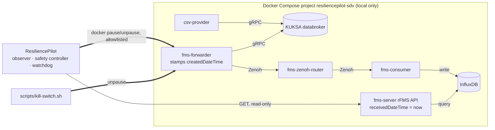
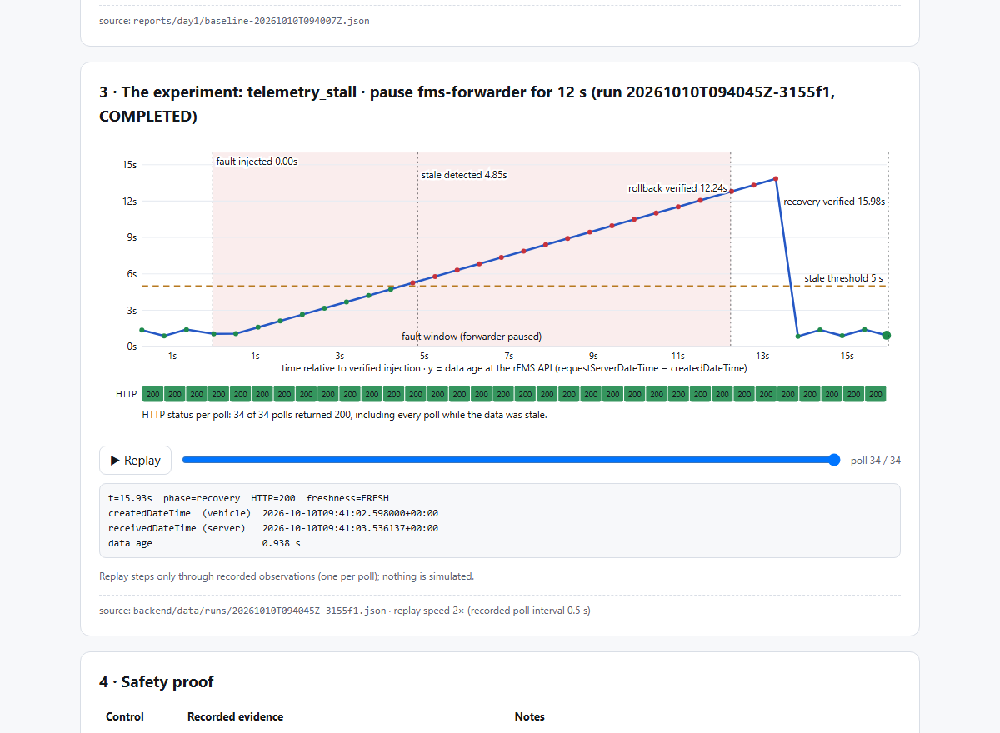

# Bosch-2026
Bosch Hackathon

## ResiliencePilot SDV

A local resilience workbench for the [Eclipse SDV Fleet Management Blueprint](https://github.com/eclipse-sdv-blueprints/fleet-management)
(pinned as a submodule at `3d514ac72a`). It shows that the blueprint's rFMS API can keep answering **HTTP 200 with a
fresh-looking `receivedDateTime` while the vehicle telemetry (`createdDateTime`) is frozen**. It detects that, injects
the fault on purpose under a deterministic safety controller, rolls it back, and verifies recovery from the data itself.

Status: **Day 1, Phases 0–2.** See `docs/coordination/CURRENT_STATUS.md`. Not production software and not
safety-certified. Faults only ever target the local sandbox.

**Contents:** [Architecture](#architecture) · [Setup](#setup-windows--docker-desktop-git-bash) ·
[Demo](#demo) · [Results](#results) · [Limitations](#limitations) · [Documentation](#documentation)

### Architecture



Full dependency map with source evidence: `config/dependency_map.json` (`python -m resiliencepilot deps`).

### Setup (Windows + Docker Desktop, Git Bash)
```bash
git submodule update --init                      # fresh clone only
./scripts/stack-up.sh                            # pulls prebuilt images, starts 8 containers
cd backend && python -m venv .venv && .venv/Scripts/python -m pip install -e ".[test]"
.venv/Scripts/python -m pytest -q                # unit tests (RP_LIVE=1 adds live read-only tests)
.venv/Scripts/python -m resiliencepilot observe  # live freshness
.venv/Scripts/python -m resiliencepilot baseline -n 60
.venv/Scripts/python -m resiliencepilot run --duration 10 --approved-by "<your name>"
../scripts/kill-switch.sh                        # emergency stop (works even if the backend is dead)
```
Stop the stack: `./scripts/stack-down.sh`.

### Demo
```bash
RP_APPROVER="<presenter name>" ./scripts/demo-day1.sh    # ~45 s live; RP_DEMO_PAUSE=3 to slow it down
```
Talk track: `docs/demo/DAY1_DEMO.md`. Recorded real run: `docs/demo/day1-demo-run.log`.

**Day-1 explainer page** (read-only, one offline HTML file built only from recorded runs):
```bash
cd backend && .venv/Scripts/rp report                       # latest full-length COMPLETED run
.venv/Scripts/rp report --run 20261010T085737Z-c9bda7 --out reports/day1/explainer.html
```
It writes `reports/day1/explainer.html`. Open it in any browser; no server or network is needed. It has no controls that
start, stop or reset experiments.



### Results
Measured on Day 1 (details and per-run evidence: `docs/demo/DAY1_REPORT.md`, `reports/day1/`):
HTTP 200 on 100 % of polls while the forwarder was paused. Stale data was detected 4.77–5.27 s after injection.
Recovery was verified 2.64–3.73 s after rollback (6 full runs). In 5 kill-switch runs, recovery was verified every time.

### Limitations
- The fault is a container **pause**, not a network fault. There is no proxy in the stack, so no network
  degradation is claimed.
- `createdDateTime` advances every ~1.0 s although the forwarder timer is 500 ms. This is unexplained and not yet
  investigated.
- The watchdog runs in-process. A hard-killed backend leaves the fault until `kill-switch.sh` runs or the backend
  restarts.
- One experiment type, one vehicle, one host. No AI analyst, dashboard or HTTP API yet (`docs/ROADMAP.md`).

### Documentation
`CLAUDE.md` (engineering rules) · `docs/recon.md` · `docs/ARCHITECTURE.md` · `docs/DECISIONS.md` ·
`docs/testing/TESTING.md` · `docs/testing/SAFETY_REVIEW.md` · `docs/coordination/HANDOFF.md`
