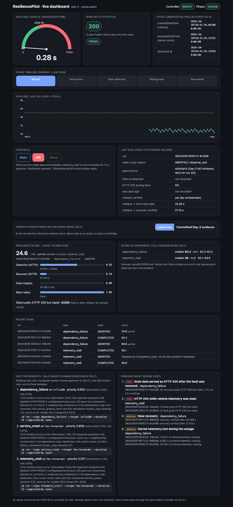
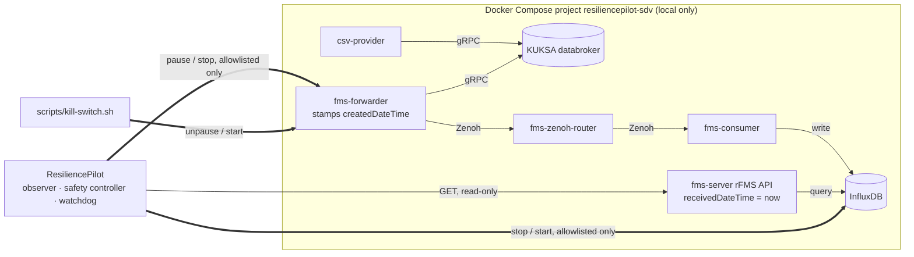

# ResiliencePilot SDV

Bosch Hackathon 2026 · a local resilience workbench for the
[Eclipse SDV Fleet Management Blueprint](https://github.com/eclipse-sdv-blueprints/fleet-management)
(pinned as a submodule at `3d514ac72a`).

**The problem it proves:** the blueprint's rFMS API keeps answering **HTTP 200**, with a fresh-looking
`receivedDateTime`, while the vehicle telemetry (`createdDateTime`) is frozen. A health check that looks at HTTP
status or "container running" calls that healthy. ResiliencePilot detects the gap from real observations, injects
faults on purpose behind a deterministic safety controller, rolls them back, and verifies recovery from advancing
telemetry, never from HTTP 200 alone.

Not production software and not safety-certified. Faults only ever target the local Compose sandbox.



**Contents:** [Results](#results) · [How it works](#how-it-works) · [Quick start](#quick-start) ·
[Commands](#commands) · [Safety model](#safety-model) · [What the AI does](#what-the-ai-does-and-does-not-do) · [Limitations](#limitations) · [Documents](#documents)

## Results

All numbers come from recorded live runs (`reports/day1/`, `reports/day2/`). Resilience Score 0–100, formula in
`docs/SCORING.md`; medians over runs that held the fault for the full requested window.

| Experiment | Fault | Completed runs | Score median (range) | What we measured |
|---|---|---|---|---|
| `telemetry_stall` | `docker pause fms-forwarder` | 8 (6 Day 1 + 2 Day 2) | Day 2: 62.2 (60.9–63.5) · Day 1: 55.4 (54.2–56.9) | HTTP 200 on 100 % of fault polls while data froze; stale detected 4.8–5.3 s after injection; recovery verified 2.6–3.7 s after rollback |
| `service_crash` | `docker stop/start fms-forwarder` | 5 | 65.1 (61.9–65.3) | Same silent symptom as the pause; the forwarder ignores SIGTERM (always SIGKILL, exit 137); recovery 2.5–3.7 s |
| `dependency_failure` | `docker stop/start influxDB` | 3 | 61.6 (57.5–63.2) | Visible failure (HTTP 500), but recovery takes 20.5–24.2 s after InfluxDB is back. Cause not verified: name-resolution errors were seen in fms container logs during the runs (log excerpts not committed), and failed-DNS caching is a hypothesis; stored-data gaps of 4.0–30.7 s (no buffering) |

Day-1 runs predate the blast-radius guard, so their scores leave that component out; compare within a day.

**Most severe findings** (`reports/day2/findings.md`, generated by `rp findings`):
1. **Silent failure after recovery.** In 2 `dependency_failure` runs the API answered HTTP 200 with stale data for
   ~21–24 s *after* InfluxDB was back (cause not verified; hypothesis: fms-consumer kept failing name resolution). One run did not recover within 30 s and
   latched. A container or HTTP health check would have called both healthy.
2. **HTTP 200 while vehicle telemetry is stale** in every `telemetry_stall` and `service_crash` run.
3. **Slow recovery** (20.5–27.1 s) and **stored-data loss** during InfluxDB outages.

## How it works



One-page overview: `docs/ARCHITECTURE_OVERVIEW.md`. Dependency map with source evidence:
`config/dependency_map.json`; `rp discover` re-derives it from `docker inspect` and diffs the two.

## Quick start

Prerequisites: Docker Desktop (Compose v2.24+), Python 3.13, git. Free local ports: 8081, 8086, 3000, 7447 and
55557 (databroker host port; upstream uses 55555, see D-021; change it with `RP_DATABROKER_HOST_PORT`).

Platforms tested: **Windows 11 x86-64** (Git Bash, Docker Desktop on WSL2) and **macOS on Apple Silicon (arm64)**.
On Apple Silicon, `fms-server` and `fms-consumer` have no arm64 image; the override pins them to `linux/amd64`
and Docker Desktop runs them under emulation (D-023). Linux was not tested.

```bash
git clone https://github.com/Anshu-raj-co/ResiliencePilot.git && cd ResiliencePilot
git -c core.longpaths=true submodule update --init   # long-paths flag avoids "Filename too long" on Windows
./scripts/stack-up.sh && ./scripts/stack-status.sh    # 8 containers; HTTP 200 with vehicle data; exits 1 if any is down
cd backend && python3.13 -m venv .venv
.venv/bin/pip install -e ".[test]"                    # Windows: .venv/Scripts/...
.venv/bin/python -m pytest -q                         # 315 unit tests (RP_LIVE=1: 318, adds live read-only tests)
.venv/bin/rp serve                                    # dashboard at http://127.0.0.1:8765/
```

If a port is taken, stop the other program; the databroker port can be moved, e.g.
`RP_DATABROKER_HOST_PORT=55600 ./scripts/stack-up.sh`. Stop the stack with `./scripts/stack-down.sh`.

## Commands

| Command | What it does | Changes anything? |
|---|---|---|
| `rp observe` / `rp baseline -n 60` | Live freshness; baseline with load conditions | no |
| `rp run --type T --target X --duration S --approved-by NAME` | One approved experiment through the safety controller | **yes** (allowlisted fault, auto rollback) |
| `rp stop` · `scripts/kill-switch.sh` | Emergency stop (kill switch works with the backend dead) | rolls back |
| `rp reset --operator NAME --note TEXT` | Clears a latch/stop after a human check; needs 3 fresh advancing polls | safety state only |
| `rp score` · `rp plan` · `rp findings` | Resilience Score, rule-based experiment ranking, findings report | no |
| `rp discover` | Dependency graph from `docker inspect`, diffed against the map | no |
| `rp advise [--offline]` | Advisory AI planner + analyst on local Ollama, rule-based fallback | no |
| `rp serve` | Dashboard + local API on 127.0.0.1:8765 | **yes**: pick one ranked experiment, approve with your typed name |

Demo: `docs/demo/DAY2_DEMO_SCRIPT.md` (3 minutes). Day-1 scripted demo: `RP_APPROVER="<name>" ./scripts/demo-day1.sh`.

## Safety model

- Faults only against **exact allowlisted container names** with the matching Compose-project label; only
  predefined experiment types with strict validation.
- One experiment at a time across processes; total fault time ≤ 30 s, enforced by a watchdog thread.
- Rollback in `finally` on completion, cancel, timeout, observer loss, any exception, and automatic guardrails
  (error rate, latency p95, blast radius).
- **Recovery** = rollback verified by `docker inspect` **and** `createdDateTime` advancing 3 times, fresh, with
  HTTP 200. Otherwise **LATCHED_UNSAFE** until a logged human reset.
- The AI is advisory: no shell, Docker, credentials or safety state; it can only reorder allowlisted proposals,
  and every analyst answer is checked against the recorded evidence (`docs/AI_LAYER.md`).

Full rules: `CLAUDE.md`. Decisions: `docs/DECISIONS.md` (D-001 … D-023).

## What the AI does and does not do

The AI is advisory only. Detection, severity ranking, the score and every safety decision are deterministic code.

| The AI does | The AI does not |
|---|---|
| Reorder the rule-based list of allowlisted experiments and give a reason for each (AI Planner) | Choose or start an experiment: every run needs a named human approver |
| Suggest a root cause and a verify / mitigate / fix playbook per finding (AI Analyst) | Rank findings by severity: `findings.py` does that with fixed rules |
| Run locally (Ollama `qwen2.5:7b`, loopback only); its text is labelled `ollama:<model>` | Compute or change the Resilience Score: `scoring.py` does that deterministically (`docs/SCORING.md`) |
| Get every answer checked: wrong order or ungrounded root cause → replaced by the rule-based answer | Touch the shell, Docker, credentials, the safety controller, rollback or recovery decisions |

In the one recorded real model call (`reports/day2/ai_advice_qwen2.5-7b.md`), the planner returned the same order as
the rules, and **1 of 7** analyst explanations passed validation; the other 6 were replaced by rule-based text.

## Limitations

- Faults are container pause/stop only. There is no proxy in the stack, so no network degradation is claimed.
- `dependency_failure` under the 5 s envelope aborted on the first fault poll in 3 of 5 runs; the 8 s envelope
  (D-022) has one run so far, in which the wider limit was not needed, and it observes only the first ~4 s of a 12 s
  window.
- The local 7B model adds little: 1 of 7 analyst answers passed the evidence check; the 14B model is too slow on a
  16 GB laptop. The deterministic layer carries the analysis.
- The watchdog runs in-process; a hard-killed backend leaves the fault until the kill switch or a restart.
- One vehicle, one host. Small samples (n = 2–8 per experiment).

## Documents

| Document | |
|---|---|
| `docs/ARCHITECTURE_OVERVIEW.md` | One-page architecture |
| `docs/demo/DAY2_DEMO_SCRIPT.md` | 3-minute demo video script |
| `reports/day2/findings.md` | Findings report (generated from 21 run records) |
| `docs/TEAM_FORM_INFO.md` | Submission form information |
| `docs/SCORING.md` · `docs/AI_LAYER.md` | Score formula · AI layer and its measurements |
| `reports/day2/README.md` · `docs/demo/DAY1_REPORT.md` | Per-run evidence, Day 2 and Day 1 |
| `docs/recon.md` · `docs/ARCHITECTURE.md` · `docs/DECISIONS.md` | Recon, detailed architecture, decision log |
| `docs/testing/TESTING.md` · `docs/testing/SAFETY_REVIEW.md` | Tests and safety review |
