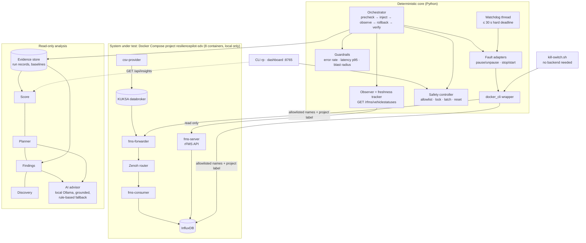

# ResiliencePilot SDV · Architecture overview

**One sentence:** a local tool that injects bounded, reversible faults into the Eclipse SDV Fleet Management
Blueprint, measures what an API client actually sees, and only declares recovery when vehicle telemetry is advancing
again. Detailed design: `docs/ARCHITECTURE.md`.

## Components

| Layer | Modules | Responsibility |
|---|---|---|
| Observe | `sdv_adapter.py`, `telemetry.py`, `baseline.py` | Poll the rFMS API; classify each poll FRESH / STALE / error from `createdDateTime` age (5 s threshold), not from HTTP status |
| Control | `safety.py`, `orchestrator.py`, `faults.py`, `guardrails.py`, `docker_cli.py` | Validate the request, take the cross-process lock, inject, watch guardrails, roll back in `finally`, verify recovery, latch on doubt |
| Evidence | `evidence.py` | One JSON record per run: every poll, timeline, rollback, recovery, data gap, guardrail state |
| Analyse | `scoring.py`, `planner.py`, `findings.py`, `discover.py`, `insights.py` | Resilience Score, experiment ranking, findings report, dependency discovery; all read-only |
| Advise | `ai.py` | Local LLM planner + analyst; isolated imports, loopback-only, validated and grounded, rule-based fallback |
| Interfaces | `__main__.py` (`rp`), `api.py` + `static/dashboard.html`, `scripts/*.sh` | CLI, localhost dashboard, stack scripts, kill switch |

## Run lifecycle

`VALIDATED → PRECHECK (3 fresh polls) → INJECTING → ACTIVE (observe; guardrails; watchdog) → ROLLING_BACK →
VERIFYING_RECOVERY → COMPLETED | ABORTED | LATCHED_UNSAFE`

- **Recovery** needs rollback verified by `docker inspect` **and** 3 successive advances of `createdDateTime` past
  both the last frozen value and the server time of the last fault-window poll, each fresh and HTTP 200.
- **LATCHED_UNSAFE** whenever rollback or recovery cannot be verified; only a logged human `reset` with fresh,
  advancing telemetry clears it.

## Experiments (allowlist: `config/experiments.json`)

| Type | Target | Mechanism | Max | Notes |
|---|---|---|---|---|
| `telemetry_stall` | fms-forwarder | `docker pause` | 30 s | Silent: HTTP 200 + frozen data |
| `service_crash` | fms-forwarder | `docker stop -t 2` / `start` | 15 s | Same container id required for rollback |
| `dependency_failure` | influxDB | `docker stop -t 2` / `start` | 15 s | Expected HTTP 500 is the symptom; 8 s / 7.5 s response envelope (D-022) |

## Trust boundaries

1. **Sandbox only:** exact container names plus the `com.docker.compose.project` label; nothing else is touched.
2. **Safety path is deterministic:** the UI, API and AI can request, never decide. The watchdog and kill switch work
   independently of the API and UI, and the kill switch works without the backend.
3. **AI is advisory:** no shell, Docker, credentials or safety state; it can only reorder allowlisted proposals,
   and its root causes must match the recorded evidence or are replaced by the rule-based answer.
4. **Evidence over claims:** every number in reports and on the dashboard is read from a run record.

## Tech

Python 3.13 (FastAPI, httpx, pydantic), Docker CLI, vanilla HTML/SVG dashboard, Ollama (`qwen2.5:7b`) for the
optional AI layer. 270 unit tests; live tests behind `RP_LIVE=1`.
