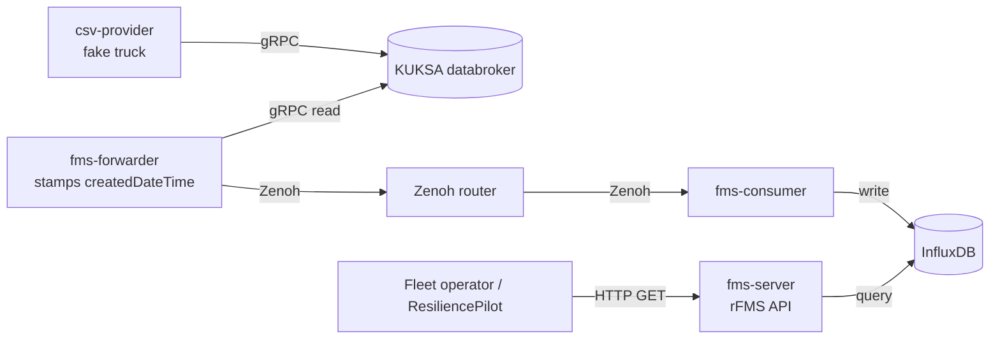

# ResiliencePilot SDV: the A-to-Z guide

A complete, beginner-friendly guide to the project. Every technical word is explained in brackets the first time it
appears, and there is a glossary at the end. Every number in this guide comes from a real run recorded in `reports/`;
nothing is invented.

**Contents**
1. [The project in 60 seconds](#1-the-project-in-60-seconds)
2. [The problem we found](#2-the-problem-we-found)
3. [The system we test (the Eclipse SDV blueprint)](#3-the-system-we-test-the-eclipse-sdv-blueprint)
4. [How ResiliencePilot works: all the parts](#4-how-resiliencepilot-works-all-the-parts)
5. [The pipelines (how data and actions flow)](#5-the-pipelines-how-data-and-actions-flow)
6. [The three experiments](#6-the-three-experiments)
7. [The safety model](#7-the-safety-model)
8. [The Resilience Score](#8-the-resilience-score)
9. [The frontend (the live dashboard)](#9-the-frontend-the-live-dashboard)
10. [The AI agent: what it is and how it helps](#10-the-ai-agent-what-it-is-and-how-it-helps)
11. [Tech stack: what we used and why we chose it over alternatives](#11-tech-stack-what-we-used-and-why-we-chose-it-over-alternatives)
12. [Hackathon guidelines checklist](#12-hackathon-guidelines-checklist)
13. [Results](#13-results)
14. [Roadmap: what was built when, and what comes next](#14-roadmap-what-was-built-when-and-what-comes-next)
15. [How to run it](#15-how-to-run-it)
16. [Commands reference](#16-commands-reference)
17. [Limitations (honest caveats)](#17-limitations-honest-caveats)
18. [Glossary](#18-glossary)

---

## 1. The project in 60 seconds

Modern trucks and cars send a constant stream of data (**telemetry**: automatic measurements such as speed, position
and fuel level, sent from the vehicle) to a server in the cloud. Fleet operators read that data through an **API**
(Application Programming Interface: a fixed way for one program to ask another program for data).

The usual way to check that such a server is "healthy" is to ask it something and see whether it answers with
**HTTP 200** (the standard web code meaning "OK, here is your answer").

**Our discovery:** in the official Eclipse fleet-management demo system, the API keeps answering "200 OK" even when
the vehicle data has stopped updating. The answer looks healthy, but the data is **stale** (old, no longer being
refreshed). A normal health check would say everything is fine.

**ResiliencePilot** is a tool that:
1. Watches the API like a real client and judges health by **how old the vehicle data is**, not by the HTTP code.
2. Breaks things on purpose, in a safe and controlled way (**fault injection**: deliberately causing a failure to
   see how the system reacts), for at most 30 seconds.
3. Undoes the fault (**rollback**) and only says "recovered" when fresh vehicle data is flowing again.
4. Records everything as evidence, scores how resilient the system was, and suggests what to test next.

**Tagline:** *HTTP 200 is not recovery. Fresh data is.*

This practice is called **chaos engineering** (testing a system by deliberately injecting failures to find weak spots
before real outages find them), and the quality we measure is **resilience** (how well a system keeps working and
recovers when parts of it fail).

---

## 2. The problem we found

Each answer from the fleet API carries two timestamps:

| Field | Who sets it | What it really means |
|---|---|---|
| `createdDateTime` | The vehicle side (the `fms-forwarder` service) | When the data was actually produced. **This is the truth.** |
| `receivedDateTime` | The server, at the moment you ask | Just "the time now" on the server. It **always** looks fresh. |

When the vehicle side stops, `createdDateTime` freezes but `receivedDateTime` keeps ticking, and the HTTP code stays
200. So the server looks perfectly healthy while serving old data. This is called a **silent failure** (a failure
that produces no error message, so normal monitoring does not notice it).

What our tool shows on screen during a fault (a real run):

```
HTTP 200  createdDateTime=09:21:59.394  receivedDateTime=09:22:04.552  age=5.159s   STALE  <- HTTP 200 but STALE
HTTP 200  createdDateTime=09:21:59.394  receivedDateTime=09:22:11.304  age=11.911s  STALE  <- HTTP 200 but STALE
```

**How we judge freshness.** Data is **STALE** if either check fails:
- **Age:** `server time − createdDateTime` is more than 5 seconds.
- **Progression:** `createdDateTime` has not moved forward for more than 5 seconds.

Why 5 seconds? In normal operation the data was never older than 1.3 s, and it updates about once per second. So
5 s gives about 3.8 times headroom with zero false alarms in 60 baseline samples (decision D-008).

---

## 3. The system we test (the Eclipse SDV blueprint)

**SDV** means Software-Defined Vehicle (a vehicle whose features are mostly controlled by software that can be
updated, rather than fixed hardware). **Eclipse SDV** is an open-source community run by the Eclipse Foundation that
builds shared software for such vehicles.

We test their **Fleet Management Blueprint** (a ready-made reference application that shows how to collect data from
a fleet of trucks). It is open source under the **Apache-2.0 licence** (a permissive licence that lets anyone use and
modify the code). We include it unchanged as a **git submodule** (a pointer to another Git repository, pinned to an
exact version, here commit `3d514ac72a`) in `Fleet Management/fleet-management/`.

It runs as 8 **containers** (small, isolated packages that each hold one program plus everything it needs to run)
started together with **Docker Compose** (a tool that starts a group of containers from one description file):

| Container | What it does, in plain English |
|---|---|
| `csv-provider` | Pretends to be a truck: replays recorded truck signals from a CSV file, over and over |
| `databroker` (Eclipse KUKSA) | The in-vehicle "notice board" where signals are posted and read, using the **VSS** standard (Vehicle Signal Specification: a common naming scheme for vehicle data) |
| `fms-forwarder` | Reads the notice board, builds a vehicle status about once per second, **stamps `createdDateTime`**, and sends it out |
| `fms-zenoh-router` (Eclipse Zenoh) | The message router between the vehicle and the cloud (Zenoh: a fast publish/subscribe messaging protocol, where senders publish messages and interested receivers subscribe to them) |
| `fms-consumer` | Cloud side: receives statuses and writes them into the database |
| `influxDB` | A **time-series database** (a database built for values that change over time, each stored with a timestamp) |
| `fms-server` | The **rFMS API** (rFMS: a truck-industry standard API for reading fleet data) that fleet operators call |
| `grafana` | A charting tool for viewing the data (not on the data path) |

We did not choose Zenoh, KUKSA or InfluxDB; they come with the blueprint. We test the system **as its authors built
it**, not a simplified copy.

Two small local adaptations (we never edit the blueprint files themselves):
- **Network type:** the blueprint uses `overlay` networks, which need Docker Swarm (Docker's multi-machine cluster
  mode). Our override file `config/compose/resiliencepilot.override.yaml` switches them to `bridge` (single-machine
  networks) with the same layout (decision D-002).
- **Line endings:** on Windows, Git can convert file line endings and break a database start-up script; `stack-up.sh`
  fixes this automatically (D-005).

---

## 4. How ResiliencePilot works: all the parts

Our code is a **Python** package in `backend/resiliencepilot/`. Each file has one job:

| Layer | File | Job, in plain English |
|---|---|---|
| **Observe** | `sdv_adapter.py` | Calls the fleet API (`GET /rfms/vehiclestatuses`) and reads the answer. Read-only. |
| | `telemetry.py` | Decides FRESH or STALE for each answer, using `createdDateTime`, never the HTTP code. |
| | `baseline.py` | Records normal behaviour (a **baseline**: a set of measurements taken when nothing is wrong, used for comparison). |
| **Control** | `safety.py` | The **safety controller**: checks every request, holds the "one experiment at a time" lock, and can lock the whole tool in an unsafe state. |
| | `orchestrator.py` | Runs one experiment step by step (check, inject, watch, roll back, verify). |
| | `faults.py` | **Fault adapters**: the only code that pauses/stops and unpauses/starts a container. |
| | `guardrails.py` | Automatic tripwires that abort an experiment early if errors, slowness or side effects appear. |
| | `docker_cli.py` | The single gateway to Docker. Tests replace it with a fake, so they need no real Docker. |
| **Evidence** | `evidence.py` | Saves one JSON file per run with every poll, every action, and every timing. |
| **Analyse** (read-only) | `scoring.py` | Computes the Resilience Score (section 8). |
| | `planner.py` | Ranks which experiment to run next (rule-based). |
| | `findings.py` | Turns run records into a ranked findings report. |
| | `discover.py` | Re-discovers how containers depend on each other from `docker inspect` and compares it with our map. |
| | `insights.py` | Packs score, plan and findings for the dashboard. |
| **Advise** | `ai.py` | The optional AI advisor (section 10). |
| **Interfaces** | `__main__.py` | The `rp` command-line tool. |
| | `api.py` + `static/dashboard.html` | The local web server and the dashboard page (section 9). |
| | `explainer.py` | Builds a standalone HTML report of a run (`rp report`). |

Other important folders:

| Folder | What is in it |
|---|---|
| `contracts/` | **JSON Schemas** (strict machine-readable rules for what a valid message looks like) for experiment requests, observations and run records |
| `config/` | `safety.json` (limits), `experiments.json` (the allowlist of experiments), `dependency_map.json` (which container talks to which, with evidence), `ai.json` (AI settings) |
| `scripts/` | Start/stop the stack, check status, the **kill switch**, and the Day-1 demo |
| `reports/` | Committed evidence from real runs (`day1/`, `day2/`) |
| `backend/tests/` | 270 automated tests |

---

## 5. The pipelines (how data and actions flow)

A **pipeline** here means a chain of steps that data or actions pass through, in order.

### 5.1 The telemetry pipeline (the blueprint's data path)



(**gRPC**: a fast way for programs to call each other over a network.) If any link from the forwarder to InfluxDB
breaks, `createdDateTime` stops advancing, but `fms-server` can keep answering 200.

### 5.2 The experiment pipeline (one run, step by step)

Every experiment moves through fixed states (a **state machine**: a design where something can only be in one
defined state at a time and moves between states by fixed rules):

```
VALIDATED → PRECHECK → INJECTING → ACTIVE → ROLLING_BACK → VERIFYING_RECOVERY → COMPLETED
                                                                         └→ ABORTED or LATCHED_UNSAFE
```

| Step | What happens |
|---|---|
| **VALIDATED** | The request is checked against the schema and allowlist; Docker confirms the target belongs to our sandbox; the run lock is taken. |
| **PRECHECK** | 3 fresh polls in a row are needed, or the run is refused (we never break an already-broken system). |
| **INJECTING** | A "fault marker" file is written **before** the fault (so a crash can be cleaned up later), the watchdog is armed, and the fault is applied. |
| **ACTIVE** | Docker confirms the fault is really active; the API is polled every 0.5 s; guardrails watch for side effects. |
| **ROLLING_BACK** | The fault is undone, and `docker inspect` confirms it. |
| **VERIFYING_RECOVERY** | We wait for `createdDateTime` to advance 3 times, fresh and with HTTP 200. |
| **COMPLETED** | Marker removed, lock released, evidence saved. |
| **LATCHED_UNSAFE** | Rollback or recovery could not be proven. Everything is blocked until a human checks and resets. |

A real 12-second run (`reports/day1/20261010T094045Z-3155f1.json`): fault applied at 1.6 s, stale detected at 6.5 s
(4.8 s after the fault), rollback at 13.6 s, recovery verified at 17.7 s.

### 5.3 The evidence and analysis pipeline

```
run record (JSON) → rp score → rp findings → rp plan → (optional) rp advise (AI)
         └──────────→ dashboard /api/insights ────────────┘
```

Every number on the dashboard and in reports is read from these run records. Analysis is **read-only**: it can never
start or stop a fault.

### 5.4 The development pipeline (how the team worked)

- Work on feature branches (`feat/...`, `fix/...`, `docs/...`), open a **pull request** (PR: a proposed change that
  others review before it is merged), run tests, merge to `main`. 21 PRs so far.
- Safety changes get an independent safety review (`docs/testing/SAFETY_REVIEW.md`).
- Every design choice is logged in `docs/DECISIONS.md` (D-001 to D-022).
- `docs/coordination/HANDOFF.md` lets anyone (or a new AI session) continue the work.

There is no cloud **CI** (Continuous Integration: a server that runs the tests automatically on every change); tests
are run locally before each merge.

---

## 6. The three experiments

All experiments are listed in `config/experiments.json`. Nothing outside this list can ever run.

| Experiment | What we break | How | Max time | What we learned |
|---|---|---|---|---|
| `telemetry_stall` | `fms-forwarder` | `docker pause` (freeze the container; `unpause` thaws it with nothing lost) | 30 s | HTTP 200 on **every** poll while data froze. Stale detected 4.8 to 5.3 s after the fault. Recovered 2.6 to 3.7 s after rollback. |
| `service_crash` | `fms-forwarder` | `docker stop` then `docker start` (a crash and restart) | 15 s | Same silent failure. The forwarder ignores the polite shutdown signal and is always force-killed. Recovered in 2.5 to 3.7 s. |
| `dependency_failure` | `influxDB` | `docker stop` then `docker start` | 15 s | The API visibly fails (HTTP 500, the "server error" code), which is good. But after the database returns, services keep failing to find it by name for 20 to 24 s, and the API serves **old data as HTTP 200** during that time. Up to 30 s of stored data was lost. |

**Why no network-slowdown experiment?** The brief asked for one "where the architecture supports it". There is no
**proxy** (a middleman program that traffic passes through and that can be told to slow it down) on the data path,
so we did not claim one. That is an honest gap, not an oversight (D-004).

---

## 7. The safety model

Breaking things on purpose is only acceptable if it is safe. These rules are enforced in code and covered by tests:

| Rule | In plain English |
|---|---|
| **Sandbox only** | Only exact, allowlisted container names that also carry our Compose project label (`resiliencepilot-sdv`). Nothing else on the machine can be touched. |
| **Allowlist only** | Only the 3 predefined experiments. Requests with unknown fields are rejected (strict validation). |
| **One at a time** | A lock file (`backend/data/run.lock`) stops two experiments running at once, even from two terminals. |
| **30-second cap** | A **watchdog** (an independent timer thread that forces a rollback when time runs out) enforces the limit, even if the main loop hangs. |
| **Emergency stop** | Three ways: dashboard **Kill** button, `rp stop`, and `scripts/kill-switch.sh`, which works **even if our backend has crashed**. |
| **Rollback always** | On completion, cancel, timeout, lost observation, any error, or a guardrail trip. |
| **Guardrails** | Abort early on unexpected errors, slowness (latency above 5 times normal), or any change to a container outside the experiment's **blast radius** (the set of things an experiment is allowed to affect). |
| **Strict recovery** | Rollback confirmed by Docker **and** 3 fresh, advancing vehicle timestamps. HTTP 200 alone never counts. |
| **Latch** | If rollback or recovery cannot be proven, the tool locks itself (LATCHED_UNSAFE) until a human checks and runs a logged reset. The reset itself requires fresh, advancing data (D-018). |
| **Crash safety** | If the backend dies mid-fault, the next start-up undoes the fault and latches (D-011). |
| **AI is advisory** | The AI has no shell, no Docker access, no credentials and no control of the safety state. |
| **No fake claims** | Never report an injection, recovery or measurement that was not actually observed. |

---

## 8. The Resilience Score

A 0 to 100 grade for how the **system under test** (the blueprint, not our tool) behaved during one fault. Details:
`docs/SCORING.md`.

```
Score = 100 × (weighted average of measured parts) × (1 − 0.5 × share of silent polls)
```

| Part | Weight | Measures |
|---|---|---|
| Detection (**MTTD**: mean time to detect) | 0.25 | How quickly the problem became visible |
| Recovery (**MTTR**: mean time to recover) | 0.30 | How quickly fresh data returned after rollback |
| Data integrity | 0.20 | How much stored data was lost |
| Blast radius | 0.25 | Whether anything outside the target changed |
| Silent-failure penalty | multiplier | Cuts the score by up to half if the API said 200 while serving stale data |

Parts that were not measured are left out, never guessed. Day-2 medians: telemetry_stall 62.2, service_crash 65.1,
dependency_failure 61.6.

---

## 9. The frontend (the live dashboard)

Start it with `rp serve`, then open **http://127.0.0.1:8765/**. It is one HTML file
(`backend/resiliencepilot/static/dashboard.html`, 264 lines) served by the local API.

### 9.1 What is on the page

| Component | What it shows | Where the data comes from |
|---|---|---|
| **Header chips** | Controller state (READY / BUSY / LATCHED_UNSAFE) and current phase | `GET /api/status` |
| **Banner** | Big warning such as "STALE while HTTP 200" | Live status |
| **Data-age gauge** | A dial (drawn in SVG, a format for drawing shapes in the browser) showing how old the vehicle data is, with the 5 s stale mark | `createdDateTime` |
| **HTTP status chip** | The API's answer code; the point is to show it stays 200 while data goes stale | Live poll |
| **Latest observation** | `createdDateTime` vs `receivedDateTime` vs time observed: the problem in one table | Live poll |
| **Phase timeline** | The run's steps lighting up: Precheck → Fault active → Stale detected → Rolling back → Recovered | Run state |
| **60-second chart** | Data age over the last minute; red when stale | Live polls |
| **Controls** | **Start** (with an "Approve and start?" confirmation), **Kill** (emergency stop), **Reset** (only allowed when blocked, with a warning) | `POST /api/run`, `/api/kill`, `/api/reset` |
| **Last run card** | Rollback verified? Recovery verified? Timings | The run's evidence record |
| **Source toggle** | Switch between "Local runs" and "Committed Day-2 evidence" | `GET /api/insights?source=...` |
| **Resilience Score card** | Latest score with a bar for each part and the silent penalty | `scoring.py` |
| **Score by experiment** | Median and range per experiment type | `scoring.py` |
| **Recent runs** | The last 10 runs (experiment history) | Run records |
| **Next experiments** | Planner proposals, as text only (no button to run them) | `planner.py` |
| **Findings** | Ranked findings with human notes | `findings.py` |

The page refreshes the live status every 0.5 s.

### 9.2 Why this frontend is genuinely good

- **Real data only.** Every number comes from the live API or a stored run record. Nothing is mocked or simulated.
- **It cannot bypass safety.** The Start button runs one fixed, pre-approved template (pause `fms-forwarder` for
  12 s). If anyone sends extra parameters, the server refuses (HTTP 422). If an experiment is already running it
  answers 409 (busy); if the tool is latched, 423 (locked). The page can only **ask**; the safety controller decides.
- **Private by default.** The server only listens on `127.0.0.1` (your own computer), so nobody on your network can
  reach it.
- **Zero build, zero dependencies.** No **framework** (a large ready-made code library such as React), no **npm**
  (the JavaScript package manager), no build step, and no internet links. It works offline and cannot break because
  a library changed.
- **Shows the story at a glance.** The green 200 chip next to a red stale gauge makes the silent failure obvious to a
  non-expert in seconds.
- **Light and dark mode**, and checked at narrow widths with no sideways scrolling.
- **Tested.** 17 API tests in `backend/tests/test_api.py`, plus a live end-to-end run started from the page.

### 9.3 What the frontend does not do (yet)

- No dependency-graph picture on the dashboard (it is available as `rp deps`, `rp discover` and in the `rp report`
  HTML page).
- Only one experiment template can be started from the page; the other two run from the CLI.
- AI advice and report export are CLI commands (`rp advise`, `rp findings`, `rp report`), not dashboard buttons.

---

## 10. The AI agent: what it is and how it helps

### 10.1 What we use

- **Model:** `qwen2.5:7b` (an **LLM**, Large Language Model: an AI that reads and writes text; "7b" means about
  7 billion internal parameters, small enough for a laptop).
- **Runtime:** **Ollama** (a free tool that runs LLMs on your own computer instead of in the cloud), on
  `http://127.0.0.1:11434`.
- **Settings** (`config/ai.json`): temperature 0 and a fixed seed (**temperature** controls randomness; 0 and a fixed
  seed make the answers repeatable), 240 s timeout.
- **Command:** `rp advise` (or `rp advise --offline` for the rule-based answer with no AI).

### 10.2 The two AI roles

| Role | What it does |
|---|---|
| **AI Planner** | Suggests the order in which to run the allowlisted experiments, with a reason. |
| **AI Analyst** | For each finding, explains a likely **root cause** (the underlying reason something failed) and a step-by-step fix plan (verify, mitigate, fix). |

### 10.3 How it is kept safe and honest

- **No power.** The AI module may only import a few basic libraries. A test fails if it ever imports anything that can
  reach Docker, the shell or the safety controller. It only ever produces text for a human to read.
- **Local only.** Any non-local AI address is refused, so no data leaves your machine.
- **Planner can only reorder.** Its answer must be an exact reordering of the allowed experiments; commands and
  durations always come from the rules, and a human still has to approve every run.
- **Grounding check** (verifying the AI's claims against the recorded facts). Each root cause must name the component
  the evidence points to, must not blame a component the evidence rules out, and must not state guesses as facts.
  If it fails, that answer is replaced by the rule-based one, and the rejected text and the reason are kept in the
  report.
- **Always a fallback.** If Ollama is off, slow or returns bad output, the deterministic rule-based answer is used.

### 10.4 How it actually helped (measured, not hoped)

- **Planner:** always gave a valid order, the same as our rule-based planner. It confirms the ranking but adds little.
- **Analyst:** 1 of 7 answers passed the grounding check (it correctly said "data loss is caused by `fms-consumer`
  dropping writes"). The other 6 were rejected because they contradicted the evidence, for example by blaming DNS
  caching (DNS: the system that turns names into network addresses) as a fact when it was only a hypothesis.
- The rejected answers became **regression tests** (tests that make sure a mistake that happened once is always
  caught in future).
- A larger model (`qwen2.5-coder:14b`) was tried, but it timed out on a 16 GB laptop.

**The honest conclusion:** the reliable analysis comes from the deterministic layer (score, findings, planner). The AI
is a helpful second opinion that adds natural-language explanation, and it is never trusted blindly. Showing that the
AI was checked and caught out is part of the project's value.

### 10.5 The AI that built the project

Separately from the AI inside the product, much of the code and documentation was written with **Claude Code**
(Anthropic's AI coding assistant), as disclosed in the commit messages. All measurements come from real runs.

---

## 11. Tech stack: what we used and why we chose it over alternatives

| We used | For | Why we chose it | Alternatives we did not choose, and why |
|---|---|---|---|
| **Eclipse SDV Fleet Management Blueprint** | The system under test | Real, open-source, Apache-2.0, prebuilt images, runs fully locally | Writing our own mock vehicle system: the brief forbids silently replacing the real system with a mock. The blueprint's Hono variant needs an external sandbox, so we used the local Zenoh variant (D-001). |
| **Docker + Docker Compose** | Running the 8 services | The blueprint ships Compose files; everyone gets identical versions; pause/stop are clean and reversible | **Kubernetes** (a system for running containers across many machines): too heavy for one laptop and not needed. **Docker Swarm**: needed only for `overlay` networks, so we switched to `bridge` instead. |
| **Docker CLI via one wrapper** | Pausing/stopping containers | One small file, easy to fake in tests; the AI never sees it | The Docker SDK or raw Docker socket: a bigger attack surface and harder to fake. |
| **Python 3.13** | All our code | Installed already, typed, fast to write and test (D-007) | Go, Java or Node.js: no real advantage here, and slower to iterate for this team. |
| **pydantic** | Validating requests | Rejects any unknown field automatically (`extra="forbid"`) | Hand-written checks: easy to miss a case. |
| **httpx** | Calling the API | Precise timeouts per request, needed for the response envelope | `requests`: less control over timeouts; no async option. |
| **FastAPI + uvicorn** | The local web API and dashboard server | Small, typed, built-in validation, easy to test | Flask (less built-in validation), Django (far too large for a few endpoints). |
| **Vanilla HTML/CSS/JS + SVG** | The dashboard | No build, no npm, no internet; one file to review | React, Vue or Angular: a build toolchain and many dependencies for a single page. Grafana: cannot show our safety state or controls. |
| **pytest** | 270 automated tests | The Python standard for tests; simple fakes | unittest: more boilerplate. |
| **Ollama + qwen2.5:7b** | Optional AI advisor | Free, runs offline on a laptop, no data leaves the machine, repeatable settings | Cloud LLM APIs (OpenAI, Anthropic, etc.): would send fleet data off the machine and need keys and internet; we wanted the AI fully local and replaceable. Training our own model: the brief says not to without a strong reason. |
| **Container pause / stop as faults** | Fault injection | Real, reversible, verifiable with `docker inspect`, and on the verified data path | Chaos tools such as Chaos Mesh or LitmusChaos (built for Kubernetes), Toxiproxy (a proxy that would have to be inserted into the path, changing the system), Gremlin (commercial cloud service). Our own small adapters keep the safety controller in full control. |
| **JSON files as the evidence store** | Run records | Human-readable, easy to commit as proof, no database to run | SQLite or PostgreSQL: unnecessary for tens of runs, and harder to review in Git. |
| **Git + GitHub PRs** | Teamwork | Review before merge, full history | — |

---

## 12. Hackathon guidelines checklist

Measured against `docs/BRIEF.md`. The brief's **OVERRIDES** section takes priority; where it changed a requirement we
say so.

- [x] = done and verified
- [ ] = not done, or only partly done (the note says which)

### 12.1 Product vision: the 12-step core workflow

- [x] 1. Connect to a verified local SDV application (blueprint, 8 containers)
- [x] 2. Discover and document service dependencies and the real telemetry path (`config/dependency_map.json`, `rp discover`, `docs/recon.md`)
- [x] 3. Collect a normal operating baseline (`rp baseline`, `reports/day1/baseline-*.json`)
- [x] 4. AI analyst recommends approved experiments (`rp advise`, plus the rule-based planner)
- [x] 5. Present hypothesis, target, expected symptoms, duration and risks (`config/experiments.json`, `rp plan`)
- [x] 6. Require approval before execution (`--approved-by`, dashboard confirmation)
- [x] 7. Inject a bounded, reversible fault through a validated adapter
- [x] 8. Measure actual behaviour during the fault
- [x] 9. Roll back and independently verify recovery
- [ ] 10. Compare predicted vs actual symptoms. **Partly:** hypotheses are recorded per experiment and findings are measured, but there is no side-by-side "predicted vs observed" table.
- [x] 11. Ranked findings, evidence and remediation (`reports/day2/findings.md`, AI analyst playbooks)
- [x] 12. Save experiment history and export a reproducible report (`reports/`, `rp report`, `rp findings`)

### 12.2 Phase 0: Reconnaissance and specification

- [x] Researched the real blueprint, licence, configuration and telemetry path (`docs/recon.md`)
- [x] Architecture, decisions, contracts, task board, roadmap
- [x] Verified facts vs inferences labelled ([V]/[I]/[Q] in recon)

### 12.3 Phase 1: Real pipeline and baseline

- [x] Local SDV integration runs
- [x] Real telemetry observed
- [x] Baseline contains real measurements
- [x] Stale and non-advancing telemetry detected by tested logic
- [x] Setup is reproducible (also verified on a fresh macOS install: all 8 containers, 270 tests passing)

### 12.4 Phase 2: Safety controller and first experiment

- [x] State machine, strict validation, one-active lock, 30 s hard limit
- [x] Watchdog, emergency stop, rollback, recovery verification, auditable timeline
- [x] Telemetry-stall experiment on the verified path
- [x] Tests for success, timeout, cancellation, invalid target, malformed request, concurrent request, observer loss, rollback failure and recovery failure

### 12.5 Phase 3: Additional experiments

- [x] Service crash/restart (`service_crash`)
- [x] Dependency failure (`dependency_failure`, stopping InfluxDB)
- [ ] Network degradation. **Not done, on purpose:** no proxy exists on the data path, and the brief says not to assume one.
- [x] Hypotheses, baseline/fault/recovery observations, stop reason and rollback outcome recorded per run
- [x] Time-to-detection and time-to-recovery calculated from timestamps
- [x] Repeated runs with variability reported (n = 2 to 8 per experiment; small samples are stated honestly)

### 12.6 Phase 4: Evidence-driven AI analyst

- [x] Ranks only approved, predefined experiments
- [x] Uses dependencies, prior outcomes and diagnostic value (rule-based planner score)
- [x] Structured, validated output (exact-permutation check, schema checks)
- [x] Human approval still required
- [x] Findings reference actual evidence (run IDs)
- [x] Distinguishes confirmed findings from hypotheses (unverified causes must be hedged)
- [x] Deterministic fallback when the model is unavailable or invalid
- [x] Tests for timeouts, malformed output and unknown values
- [ ] Prompt-injection tests. **Not explicit:** there is no dedicated test that feeds hostile instructions to the model. The AI still cannot act on anything, so the risk is limited to misleading text.
- [x] No custom model trained; the AI cannot override safety

### 12.7 Phase 5: Dashboard and reporting

- [ ] Service/dependency graph with confidence labels. **Partly:** available in the CLI and the `rp report` page, not on the dashboard.
- [x] System readiness and live telemetry state
- [ ] AI-ranked proposals. **Partly:** the dashboard shows rule-based proposals; the AI ranking is in the CLI.
- [x] Human approval controls
- [x] Live experiment state and emergency stop
- [x] Fault status, rollback status and recovery verification
- [ ] Predicted vs observed comparison. **Partly** (see 12.1 step 10).
- [x] Evidence-backed findings
- [x] Experiment history (Recent runs)
- [ ] Report export from the UI. **Partly:** reports are exported from the CLI (`rp report`, `rp findings`).
- [x] Real backend state only; no UI action can bypass the safety controller (tested)

### 12.8 Phase 6: Integration and hackathon readiness

- [x] Clean-setup run
- [x] Each experiment run end to end on the live stack
- [x] Rollback and recovery verified
- [x] Unit tests (270) and live tests (`RP_LIVE=1`)
- [x] Failure paths tested
- [x] Documentation: installation, architecture, testing, limitations
- [x] Demo script (`docs/demo/DAY2_DEMO_SCRIPT.md`)
- [x] Screenshots from real runs only
- [x] Unfinished requirements reported honestly
- [ ] Demo video recorded (the script is ready; the video link is still marked TO FILL)

### 12.9 Safety requirements (brief section 6)

- [x] Local disposable sandbox only
- [x] LLM has no shell, Docker or credentials and cannot inject, roll back or decide recovery
- [x] Predefined experiment types and validated targets only
- [x] Strict schema validation
- [x] One active experiment at a time
- [x] Maximum 30 s
- [x] Watchdog independent of the AI and frontend
- [x] Manual emergency stop
- [x] Rollback on cancel, timeout, threshold violation and observer loss
- [x] Recovery from advancing telemetry, never HTTP 200 alone
- [x] Latched unsafe state with a safe reset
- [x] Cleanup robust against exceptions and crashes
- [x] Full record of each run
- [x] Negative paths tested
- [x] No fabricated measurements

### 12.10 Structure, Git and teamwork

- [x] `CLAUDE.md`, `README.md`, `.gitignore`, `docs/*`, `contracts/`, `config/`, `backend/`, `backend/tests/`, `reports/`, `scripts/`
- [ ] Separate `frontend/` and `experiments/` folders. **Equivalent instead:** the dashboard lives in `backend/resiliencepilot/static/` and the experiment catalogue in `config/experiments.json` (the brief allows equivalent locations).
- [x] Feature branches, PRs, `main` kept stable, no force-push, no secrets
- [x] Coordination files (`CURRENT_STATUS.md`, `TASK_BOARD.md`, `HANDOFF.md`)
- [ ] Five named teammates. **Partly:** the task board defines 5 roles; names in `docs/TEAM_FORM_INFO.md` are still TO FILL.
- [x] Agent Teams: not used, **by override #3** (single session; subagents for safety review only)

### 12.11 Submission deliverables

- [x] `README.md`
- [x] `docs/demo/DAY2_DEMO_SCRIPT.md`
- [x] `docs/ARCHITECTURE_OVERVIEW.md`
- [x] `reports/day2/findings.md`
- [x] `docs/TEAM_FORM_INFO.md` (team fields still to fill)

---

## 13. Results

From recorded live runs (`reports/day1/`, `reports/day2/`):

| Experiment | Completed runs | Score median (range) | Key measurement |
|---|---|---|---|
| telemetry_stall | 8 | 62.2 (60.9–63.5) on Day 2 | HTTP 200 on 100 % of fault polls while data froze |
| service_crash | 5 | 65.1 (61.9–65.3) | Same silent failure; recovery 2.5–3.7 s |
| dependency_failure | 3 | 61.6 (57.5–63.2) | Recovery 20.5–24.2 s; stored-data gaps up to 30.7 s |

**Top findings** (`reports/day2/findings.md`):
1. **Did not recover within 30 s** after a database outage (one run latched).
2. **Stale data served as HTTP 200 after the fault was removed**, for about 21 to 24 s, while every container looked
   healthy. This is the strongest finding: a container or HTTP health check would have called it healthy.
3. **HTTP 200 while telemetry was stale** in every forwarder pause and crash.
4. **Slow recovery** and **stored data lost** during database outages (no buffering).

---

## 14. Roadmap: what was built when, and what comes next

| Phase | Goal | Status |
|---|---|---|
| 0 | Research the real system, plan, contracts | Done (Day 1) |
| 1 | Run the real pipeline, baseline, stale detection | Done (Day 1) |
| 2 | Safety controller, first experiment, kill switch, verified recovery | Done (Day 1) |
| 3 | More experiments (crash, dependency failure), guardrails, repeated runs | Done (Day 2), except network degradation |
| 4 | AI planner and analyst, scoring, findings | Done (Day 2) |
| 5 | Live dashboard with insights | Done (Day 1 and Day 2), with the gaps listed in 9.3 |
| 6 | Clean setup, docs, demo script, submission pack | Done, except the demo video |

**Sensible next steps:**
- Record the demo video and fill in the team details.
- Add a predicted-vs-observed table and the dependency graph to the dashboard.
- More `dependency_failure` runs (n = 3 is small).
- New experiments on the verified path: pause `fms-consumer`, pause the Zenoh router.
- Network degradation only if a real mechanism can be placed on the path (for example `tc netem`, a Linux tool that
  slows or drops network traffic).
- Two safety follow-ups from the review (listed in `docs/ROADMAP.md`): an in-memory latch fallback and a safer order
  of steps in `reset()`.
- Prompt-injection tests for the AI layer.
- An outside watchdog process, so a hard-killed backend cannot leave a fault running.

---

## 15. How to run it

Prerequisites: Docker Desktop (running), Python 3.13, Git.

```bash
git clone --recurse-submodules https://github.com/Anshu-raj-co/ResiliencePilot.git
cd ResiliencePilot
chmod +x scripts/*.sh                                  # macOS/Linux: make scripts runnable
./scripts/stack-up.sh && ./scripts/stack-status.sh     # starts 8 containers
cd backend
python3.13 -m venv .venv                               # a private Python environment for this project
.venv/bin/pip install -e ".[test]"
.venv/bin/python -m pytest -q                          # expect 270 passed
.venv/bin/rp status                                    # must say READY
.venv/bin/rp serve                                     # dashboard at http://127.0.0.1:8765/
```

Stop everything with `./scripts/stack-down.sh`. On Windows use `.venv/Scripts/` instead of `.venv/bin/`.

---

## 16. Commands reference

| Command | What it does | Changes anything? |
|---|---|---|
| `rp status` | Shows the safety state and the targets | No |
| `rp observe -n 10` | Live freshness readings | No |
| `rp baseline -n 60` | Records a baseline | No |
| `rp run --type T --target X --duration S --approved-by NAME` | Runs one approved experiment | **Yes** (with automatic rollback) |
| `rp stop` / `scripts/kill-switch.sh` | Emergency stop | Rolls back |
| `rp reset --operator NAME --note TEXT` | Clears a latch after a human check | Safety state only |
| `rp runs` / `rp show RUN_ID` | Lists runs / shows one with a chart | No |
| `rp score` / `rp plan` / `rp findings` | Score, next-experiment ranking, findings report | No |
| `rp deps` / `rp discover` | Dependency map / re-discovered from Docker | No |
| `rp advise [--offline]` | AI planner and analyst | No |
| `rp report` | Standalone HTML explainer of a run | No |
| `rp serve` | Dashboard and local API | Start runs one fixed template |

---

## 17. Limitations (honest caveats)

- Faults are container pause/stop only; there is no network-degradation experiment.
- Small samples (2 to 8 runs per experiment); medians and ranges are reported, not strong statistics.
- One simulated vehicle, one machine.
- Detection time is bounded below by the 5 s stale threshold; it partly measures our monitor, not only the stack.
- The watchdog runs inside the backend process; if that process is killed hard, the fault stays until the kill
  switch or the next start-up undoes it.
- The local 7B AI model adds little; most of its answers fail the evidence check.
- Not production software and not safety-certified.

---

## 18. Glossary

| Term | Meaning |
|---|---|
| API | A fixed way for one program to ask another for data |
| Apache-2.0 | A permissive open-source licence |
| Baseline | Measurements taken when nothing is wrong, used for comparison |
| Blast radius | The set of things an experiment is allowed to affect |
| Chaos engineering | Deliberately injecting failures to find weaknesses before real outages do |
| CLI | Command-Line Interface: a program you use by typing commands |
| Container | A small, isolated package holding one program and everything it needs |
| Deterministic | Always gives the same result for the same input (no randomness) |
| Docker / Docker Compose | The tool that runs containers / the tool that starts a group of them from one file |
| Evidence record | The JSON file saved for each run, holding every measurement |
| Fault injection | Causing a failure on purpose to see how a system reacts |
| Grounding check | Verifying that an AI answer matches the recorded facts |
| Guardrail | An automatic tripwire that stops an experiment early |
| HTTP 200 / 500 | Web status codes: 200 means OK, 500 means server error |
| JSON / JSON Schema | A common text format for data / strict rules for what valid JSON looks like |
| Kill switch | An emergency stop that undoes any active fault |
| Latch (LATCHED_UNSAFE) | A locked safety state that blocks all experiments until a human resets it |
| Latency / p95 | Response time / the time within which 95 % of responses arrive |
| LLM | Large Language Model: an AI that reads and writes text |
| MTTD / MTTR | Mean time to detect / mean time to recover |
| Ollama | A tool for running LLMs on your own computer |
| Pull request (PR) | A proposed code change that is reviewed before merging |
| Resilience | How well a system keeps working and recovers when parts fail |
| rFMS | A truck-industry standard API for fleet data |
| Rollback | Undoing a fault |
| Root cause | The underlying reason something failed |
| SDV | Software-Defined Vehicle |
| Silent failure | A failure that produces no error, so normal monitoring misses it |
| Stale | Old data that is no longer being refreshed |
| State machine | A design where something moves between fixed, named states by fixed rules |
| Submodule | A pointer from one Git repository to an exact version of another |
| Telemetry | Automatic measurements sent from a vehicle |
| Time-series database | A database for values stored with timestamps |
| VSS | Vehicle Signal Specification: a standard naming scheme for vehicle data |
| Watchdog | An independent timer that forces a rollback when time runs out |
| Zenoh | A fast publish/subscribe messaging protocol used between vehicle and cloud |
