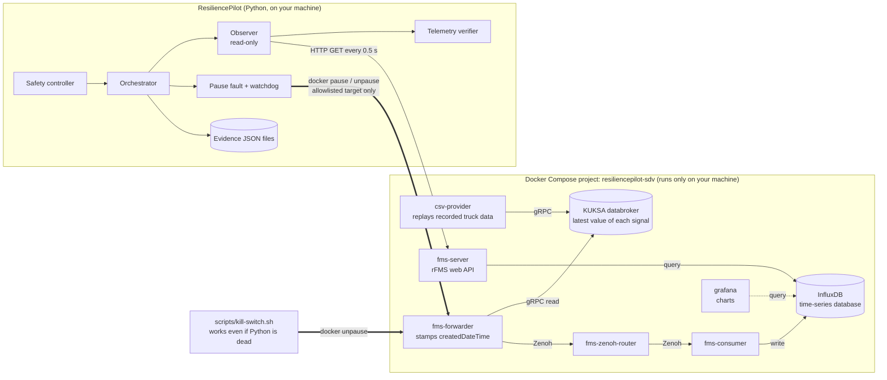

# ResiliencePilot SDV — The Project Explained

A plain-English guide for teammates, judges and new users. It assumes you are a student who is new to cloud-native
software and chaos engineering. Every technical word is explained the first time it appears, and the glossary in
§13 lists all of them.

**How to read this document.** Every fact comes from a file in this repository, named in the small *source:* line
under each section. Every number is a measurement from a real run, stored in `reports/day1/`. Anything planned but
not built is marked **Planned (Day 2)**.

---

## 1. The 60-second version

**What we built.** ResiliencePilot is a small tool that tests how well a real, open-source vehicle fleet system copes
with failure. It runs the system on your laptop, breaks one part of it on purpose for a few seconds, watches what
happens, puts the part back, and checks that the system really recovered.

**The problem it exposes.** A *web API* is a door that other programs knock on to ask for data. When the request
succeeds, the door answers with the code *HTTP 200*, which means "OK". Most *health checks* (automatic "are you alive?"
tests) stop there: if the answer is 200, the service counts as healthy.

We show that the fleet system's API keeps answering **HTTP 200 while the vehicle data behind it has stopped
updating**. It looks healthy but serves old data. Think of a shop's departure board that still lights up and shows
times, but the times froze 10 minutes ago: the board "works", yet the information is wrong.

**Why it matters for connected vehicles.** Fleet operators use this kind of data to see where trucks are, how fast
they go and how much fuel they have. Data that is ten seconds or ten minutes old, but presented as current, can lead
to wrong decisions, and a normal health check would never raise an alarm.

**What we proved, with measurements.** While we froze the part that sends vehicle data:
- 100 % of API requests still returned HTTP 200.
- ResiliencePilot flagged the data as stale 4.77–5.27 s after the freeze (6 full-length runs).
- After we undid the freeze, recovery was verified from new vehicle timestamps 2.64–3.73 s later.
- Every step ran behind a safety controller with a 30-second limit, a watchdog and a kill switch.

*source: `README.md`, `docs/demo/DAY1_REPORT.md`, `reports/day1/`*

---

## 2. The big picture

### The whole system in one diagram



Read it left to right. Truck data starts in `csv-provider`, travels through the pipeline, lands in InfluxDB and is
served by `fms-server`. ResiliencePilot sits outside the pipeline. It only **reads** from `fms-server` and only
**freezes and unfreezes** one container, `fms-forwarder`.

### The story of one experiment

This is a real run: `reports/day1/20261010T094045Z-3155f1.json`, a 12-second experiment.

1. **Approval and validation.** A person asks for the experiment "telemetry_stall on fms-forwarder for 12 s",
   giving their name and a *hypothesis* (the guess being tested): *"Pausing fms-forwarder stalls createdDateTime
   while the rFMS API keeps returning HTTP 200."* The safety controller checks the request against strict rules
   before anything happens.
2. **Baseline check (precheck).** ResiliencePilot polls the API and requires 3 fresh samples in a row first. If the
   system is already unhealthy, it refuses to break it further. This took 1.6 s.
3. **Fault.** It runs `docker pause fms-forwarder`, which freezes that container like pressing pause on a video,
   then confirms with `docker inspect` that the container really is paused.
4. **Hidden failure.** The API keeps answering HTTP 200 on every request, but the vehicle timestamp
   `createdDateTime` stops moving. The data gets older every poll.
5. **Detection.** 4.85 s after the pause, the data age passed the 5-second threshold and ResiliencePilot recorded
   **"STALE while HTTP 200"**.
6. **Rollback.** At the end of the 12-second window it runs `docker unpause fms-forwarder` and confirms with
   `docker inspect` that the container is running and not paused.
7. **Verified recovery.** It does **not** trust HTTP 200. It waits until `createdDateTime` moves forward three times
   in a row, each time fresh. The first fresh data arrived 1.59 s after rollback, and recovery was verified at
   3.73 s.
8. **Evidence.** Every poll, every action and every timestamp is saved to a JSON file you can inspect later.

*source: `README.md`, `docs/demo/DAY1_REPORT.md`, `reports/day1/20261010T094045Z-3155f1.json`,
`backend/resiliencepilot/orchestrator.py`*

---

## 3. The sample app we test: Eclipse SDV Fleet Management Blueprint

**SDV** means *Software-Defined Vehicle*: a vehicle whose features are mostly delivered by software, which can be
updated like a phone app. **Eclipse SDV** is an open-source community (part of the Eclipse Foundation) that builds
SDV software. A **blueprint** is a complete, runnable example that shows how the pieces fit together.

The **Fleet Management Blueprint** is, in its own README's words, a "close to *real-life* showcase for truck fleet
management". Trucks report data such as speed, position, fuel level and driver working state to a back end, where a
fleet operator can read it through the **rFMS API**. *rFMS* (remote Fleet Management System) is an industry standard
web API for truck data.

It is open source under the **Apache-2.0** licence. We use it unmodified, pinned as a *git submodule* (a repository
inside our repository, locked to one exact version) at upstream commit `3d514ac72a`, in the folder
`Fleet Management/fleet-management/`.

Nothing here is a real truck. The "truck" is a CSV file of recorded signals played back in a loop.

### What each container does

A **container** is a small, isolated package that holds one program plus everything it needs to run, like a
lunchbox with its own cutlery. The blueprint runs as 8 containers in our setup.

| Container | What it is | What it does here |
|---|---|---|
| `csv-provider` | Eclipse KUKSA CSV provider | Plays the "truck sensors": replays `signalsFmsRecording.csv` (4,001 rows) forever. |
| `databroker` | Eclipse **KUKSA** databroker | The in-vehicle "notice board". Holds the latest value of each vehicle signal using the **VSS** naming standard (Vehicle Signal Specification: agreed names such as `Vehicle.Speed`). |
| `fms-forwarder` | Blueprint component (Rust) | Reads the notice board, builds a `VehicleStatus` message every `TIMER_INTERVAL` (500 ms), **stamps it with `createdDateTime`** and sends it to the back end. **This is the container we freeze.** |
| `fms-zenoh-router` | Eclipse **Zenoh** router | The "post office" that carries messages from the vehicle side to the back end. |
| `fms-consumer` | Blueprint component (Rust) | Receives each `VehicleStatus` and writes it to InfluxDB. |
| `influxDB` | InfluxDB 2.7 | A **time-series database**: a database designed for values that change over time, each stored with a timestamp. |
| `fms-server` | Blueprint component (Rust) | The **rFMS web API** on `http://127.0.0.1:8081`. Answers requests by querying InfluxDB. |
| `grafana` | Grafana 9.5 | A dashboard tool that draws charts from InfluxDB (`http://127.0.0.1:3000`). Not on the data path. |

The blueprint also has a `fleet-analysis-backend` (Java). We leave it out: it has no ready-made image, building it
would need Maven and a JDK on a disk with only ~18 GB free, and it only reads InfluxDB, so it is not on the data
path (decision D-003).

The KUKSA and Zenoh links use **gRPC** (a fast way for programs to call each other over a network) and
**uProtocol** (an Eclipse standard for messages between vehicle and cloud components that works over different
transports, here Zenoh).

### The data path

```
csv-provider ──gRPC──▶ databroker ◀──gRPC read── fms-forwarder   (stamps createdDateTime = now)
                                                       │ Zenoh / uProtocol
                                                       ▼
                                               fms-zenoh-router
                                                       ▼
                                                 fms-consumer ──HTTP write──▶ InfluxDB
                                                                                 ▲
                                    fms-server (rFMS API) ──query, latest value──┘
```

The machine-readable version, with the file and line in the blueprint that proves each link, is
`config/dependency_map.json`. Show it with `python -m resiliencepilot deps`. Each link carries a *confidence* label:
- **source**: we read it in the blueprint code or config.
- **live network**: both containers share a Docker network, checked each time the map is shown.
- **experiment**: freezing the forwarder changed what `fms-server` returns.

*source: `Fleet Management/fleet-management/README.md`, `docs/recon.md` §2–4, `config/dependency_map.json`,
`docs/DECISIONS.md` D-001, D-003, `scripts/_compose.sh`*

---

## 4. What "telemetry" means here, and why a health check misses stale data

**Telemetry** is data a machine sends about itself from a distance, here a truck's speed, position, fuel and so on.
Each `VehicleStatus` the API returns has several timestamps, and choosing the right one is the core of this project.

| Field | Who sets it, and when | Useful for freshness? |
|---|---|---|
| `createdDateTime` | `fms-forwarder`, using its clock when it builds the message (`kuksa.rs:44`) | **Yes. This is our freshness signal.** It only moves forward while the whole forwarder → Zenoh → consumer → InfluxDB chain works. |
| `receivedDateTime` | `fms-server`, set to "now" at the moment you ask (`influx_reader.rs:372`) | **No.** It is always fresh, even when the data is old. This is exactly the field that makes stale data look healthy. |
| `requestServerDateTime` | `fms-server`, "now" at request time | Not for freshness, but it gives us the server's clock for the age calculation below. |
| HTTP status code | `fms-server` | **No.** It is 200 whenever InfluxDB answers, however old the data is. |
| Speed, position, fuel… | The CSV replay | **No.** These can legitimately stay the same for a while. |
| Sequence number | — | **Not available.** The message has no counter, so we use "is `createdDateTime` strictly increasing?" instead. |

### Our two staleness checks

1. **Data age** = `requestServerDateTime − createdDateTime`. How old is the newest data, according to the server's
   clock? Both timestamps come from clocks inside the same Docker virtual machine, so a wrong laptop clock cannot
   distort it.
2. **Sequence progression**: how long, by our own clock, since `createdDateTime` last moved forward? This catches a
   stall even if a server clock were wrong.

If **either** passes **5 seconds**, the sample is **STALE**. If it is STALE and the HTTP status was 200, we mark it
**healthy_but_stale**: the hidden failure.

**Why 5 seconds?** In the first baseline the oldest data was 1.30 s old, so 5 s leaves about 4× headroom. There were
no false alarms in 184 baseline samples across 6 baselines.

**Why a simple health check misses this.** A typical check asks "did the API answer 200?" During our fault it always
did, in 100 % of polls. Only by reading *inside* the answer, and comparing `createdDateTime` with the server clock,
can you see the data is frozen. It is like checking that a thermometer turns on, but not whether its reading changes.

*source: `docs/recon.md` §4, `docs/DECISIONS.md` D-008, `backend/resiliencepilot/telemetry.py`,
`docs/demo/DAY1_REPORT.md`, `config/safety.json`*

---

## 5. Our system, component by component

All code is in `backend/resiliencepilot/`.

| Component | What it does | Why it exists | File |
|---|---|---|---|
| **Dependency map** | Lists every container, every link between them, the protocol, and the blueprint file:line that proves it, with confidence labels. | You cannot choose a meaningful fault without knowing what depends on what. | `config/dependency_map.json`; shown by `__main__.py` (`deps`) |
| **SDV adapter / observer** | Sends one read-only `GET /rfms/vehiclestatuses?latestOnly=true` and turns the answer into an `Observation` (status, latency, timestamps). | It is the only part that talks to the app, and it never changes anything. | `sdv_adapter.py`, `observation.py` |
| **Telemetry verifier** | Decides FRESH / STALE / NO_DATA / OBSERVER_ERROR for each observation, and sets `healthy_but_stale`. Pure logic, no network or Docker. | It is the heart of "HTTP 200 is not the same as fresh". | `telemetry.py` |
| **Baseline collector** | Polls under normal conditions (e.g. 60 polls at 0.5 s) and records age, latency, HTTP success ratio, advance interval and load conditions. | You need "normal" before you can recognise "abnormal". | `baseline.py` |
| **Experiment orchestrator** | Runs the state machine: VALIDATED → PRECHECK → INJECTING → ACTIVE → ROLLING_BACK → VERIFYING_RECOVERY → COMPLETED / ABORTED / LATCHED_UNSAFE. Rollback sits in a `finally` block, so it runs even after an error. | It keeps every experiment in the same, auditable order. | `orchestrator.py` |
| **Safety controller** | Checks every request and holds the safety state (details below). | So no person, script or future AI can run an unsafe experiment. | `safety.py`, `config/safety.json`, `config/experiments.json` |
| **Fault adapter** | `PauseFault`: `docker pause` to inject, `docker unpause` to roll back. Rollback retries, always re-checks the real container state, and is safe to call twice. | It is the only code that changes the system, so it is kept small. | `faults.py` |
| **Watchdog** | A separate background thread with a hard deadline. If the main loop overruns, it rolls back on its own. | A hung loop must not leave the fault in place. | `faults.py` (`Watchdog`) |
| **Recovery verifier** | After rollback, requires 3 successive advances of `createdDateTime`, each fresh (≤ 5 s) with HTTP 200, and each newer than anything seen during the fault, within 30 s. | "Container running" or "HTTP 200" is not recovery. New data is. | `orchestrator.py` (`_finish`) |
| **Evidence store** | Saves every run (request, timeline, every observation, rollback, recovery, impact) and every baseline as JSON. | Claims must be checkable later. | `evidence.py` → `backend/data/` (local); curated real runs in `reports/day1/` |
| **Docker wrapper** | The single place that calls the `docker` command line. | Tests replace it with a fake, so safety logic is tested without Docker. | `docker_cli.py` |
| **CLI** | Commands: `status`, `observe`, `baseline`, `run`, `stop`, `reset`, `runs`, `show`, `deps`, `show-baseline`, `report`, `serve`. Also installed as the `rp` command. | The operator's control panel. | `__main__.py`, `views.py` |
| **Local API + live dashboard** | `rp serve` starts a FastAPI server bound to 127.0.0.1 only. It serves one static page that polls `GET /api/status` every 500 ms and shows a data-age gauge, an HTTP status chip, a phase timeline, a live chart and Start / Kill / Reset buttons. `POST /api/run` takes **no parameters** and runs one approved template (pause `fms-forwarder` for 12 s, approver `dashboard-operator`). Kill and Reset call the same safety-controller functions as the CLI. Busy → 409, latched → 423. | Lets a person run and watch the experiment live without the terminal, without adding a second path around the safety rules. | `api.py`, `static/dashboard.html` |
| **Explainer page** | `rp report` builds one standalone, offline HTML file from recorded runs: dependency map, baseline, and a chart of data age against the 5 s threshold while every poll was HTTP 200. It is read-only and has no buttons that start or stop anything. | Makes the impact easy to see for non-engineers. | `explainer.py` → `reports/day1/explainer.html` |

### The safety controller in detail

- **Allowlist.** Each experiment type lists the exact containers it may touch. `telemetry_stall` may only touch
  `fms-forwarder`. The container must also carry the Docker Compose label `com.docker.compose.project =
  resiliencepilot-sdv`, so a same-named container from another project is refused.
- **Strict schema.** The request must match exactly; unknown fields, wrong types, durations over 30 s or a blank
  approver are rejected before anything runs.
- **One-experiment lock.** A file `backend/data/run.lock`, created atomically and holding the owner's process ID. A
  second terminal is refused with BUSY. A lock left behind by a crashed process latches the system.
- **30-second watchdog.** The total fault time is capped at `min(duration + grace, 30 s)`. The grace period is
  capped at 10 s.
- **Kill switch.** Three ways: `python -m resiliencepilot stop`, Ctrl+C, or `scripts/kill-switch.sh`. The script
  works even if the Python backend has crashed. It writes an `EMERGENCY_STOP` file, unpauses every allowlisted target
  directly with Docker, retries 3 times, and exits with an error if anything is still paused.
- **Latched unsafe state.** If rollback or recovery cannot be verified, or a crash is found at the next start, the
  system enters `LATCHED_UNSAFE` and refuses all experiments until a person runs `reset` with their name and a note.
  `reset` itself refuses unless every allowlisted container is running and unpaused.

### Is there a dashboard or UI?

- **Live dashboard: yes, merged (PR #6).** `rp serve`, then open `http://127.0.0.1:8765/`. It is localhost-only and
  shows only real values; anything missing reads "not recorded". It was run end to end from the page on 2026-10-10:
  Start → stale while HTTP 200 → Kill → rollback and recovery verified → Reset.
- **Explainer page:** a static, read-only report (above), not a control panel.
- There is **no AI** in the system. **Planned (Day 2).**

*source: `docs/ARCHITECTURE.md`, `backend/resiliencepilot/*.py` (incl. `api.py`), `backend/pyproject.toml`, `config/*.json`,
`scripts/kill-switch.sh`, `docs/testing/SAFETY_REVIEW.md`, `docs/DECISIONS.md` D-009–D-011, `README.md`*

---

## 6. Tech stack, and why

| Choice | Why |
|---|---|
| **Python 3.13** | It was installed, it supports typing, and it is fast to test (D-007). |
| **pydantic** | Validates the experiment request strictly (`extra="forbid"`: any unknown field is an error). |
| **httpx** | Makes the HTTP calls to the rFMS API. |
| **pytest** | The tests on `main`: 67 unit tests, plus 3 live tests that need the running stack (70 with `RP_LIVE=1`, verified 2026-10-10). Open PRs #9 and #10 add more. |
| **`docker` command line via one wrapper** | One small file that tests can fake; no Docker socket is ever handed to any other component. |
| **FastAPI + uvicorn** | Run the local API and dashboard (`rp serve`), bound to 127.0.0.1 only. |
| **Frontend** | No framework, npm or build step. The dashboard is one static HTML file (inline CSS/JS) served by the API. The explainer is a generated HTML file that needs no server. |

### Docker and Docker Compose

**Docker** runs containers. **Docker Compose** starts a group of containers from one file that describes them all.
We use them because:
- **Reproducible sandbox.** Everyone gets the same versions of every component by pulling the same prebuilt images
  (about 1.2 GB in total).
- **Isolated blast radius.** *Blast radius* means how much can be hurt if something goes wrong. Our faults can only
  reach containers inside our own Compose project, on our own machine.
- **Easy rollback.** `docker pause` and `docker unpause` freeze and thaw a container without losing its state.

We do not edit the blueprint's Compose files. A small override file (`config/compose/resiliencepilot.override.yaml`)
changes only the network type (see §12 troubleshooting).

### Zenoh, KUKSA and InfluxDB are not our choice

They come with the blueprint. We test the system as its authors built it, rather than a simplified copy.

### Why not Kubernetes?

**Kubernetes** is a system for running containers across many machines. There is no written decision about it in
the repo. The facts are: the blueprint ships Docker Compose files as its quick start, the hackathon guidelines accept
Docker Compose, and everything runs on a single laptop. Kubernetes would add a layer the experiment does not need.

*source: `docs/DECISIONS.md` D-002, D-007, `backend/pyproject.toml`, `backend/tests/`, `scripts/_compose.sh`,
`config/compose/resiliencepilot.override.yaml`, `Fleet Management/fleet-management/README.md` (Quick Start); image
sizes from `docker images` on 2026-10-10*

---

## 7. What happens in the background during a run

The real run `reports/day1/20261010T094045Z-3155f1.json` (12 s, approved by `demo-operator`). `t` is seconds since
the request was validated.

| t (s) | State | What actually happened |
|---|---|---|
| 0.000 | VALIDATED | Request checked by the schema and allowlist; `docker inspect fms-forwarder` confirms the compose-project label; `run.lock` created. |
| 0.002 | PRECHECK | Polls `GET /rfms/vehiclestatuses?latestOnly=true` every 0.5 s. |
| 1.633 | PRECHECK | 3 fresh samples in a row, including at least one advance → passed. |
| 1.636 | INJECTING | Fault marker file written **before** the fault; watchdog armed; `docker pause fms-forwarder`. |
| 1.755 | ACTIVE | `docker inspect` shows `State.Paused == true` → fault verified. Polling continues every 0.5 s. |
| 6.486 | ACTIVE | **stale_detected**: HTTP 200, data age 5.26 s, `healthy_but_stale: true`. Time to detection 4.848 s. |
| 13.639 | ACTIVE | **fault_window_closed**, reason `duration_elapsed`. |
| 13.641 | ROLLING_BACK | `docker unpause fms-forwarder`, then `docker inspect`. |
| 14.000 | ROLLING_BACK | Rollback verified: running and not paused. |
| 14.002 | VERIFYING_RECOVERY | Polling continues, waiting for new `createdDateTime` values. |
| 17.731 | VERIFYING_RECOVERY | **recovery_verified**: first fresh after 1.592 s, 3 advances by 3.73 s. |
| 17.733 | COMPLETED | Marker cleared, watchdog cancelled, `run.lock` released, record saved. |

What you see on screen during the fault (from the same kind of run today):

```
[fault t= 6.48s] HTTP 200  createdDateTime=09:21:59.394  receivedDateTime=09:22:04.552  age=5.159s  STALE  <- HTTP 200 but STALE
[fault t=13.23s] HTTP 200  createdDateTime=09:21:59.394  receivedDateTime=09:22:11.304  age=11.911s STALE  <- HTTP 200 but STALE
```

`createdDateTime` is frozen while `receivedDateTime` keeps ticking: that is the hidden failure in one line.

*source: `reports/day1/20261010T094045Z-3155f1.json` (timeline), `reports/day1/20261010T092158Z-43ca5b.json`,
`backend/resiliencepilot/orchestrator.py`, `docs/ARCHITECTURE.md` (state machine)*

---

## 8. The safety model in plain English

**What is guaranteed by the code and tested:**
- Only one predefined experiment type exists, and it can only touch `fms-forwarder` in our own Compose project.
- Malformed, unknown or over-long requests are rejected before anything runs.
- Only one experiment at a time, even across separate terminals.
- The fault is undone on every exit path: normal end, timeout, Ctrl+C, kill switch, lost observation, non-200
  answer, or a Python error.
- Recovery is decided from new data, never from HTTP 200 or "container running".
- If anything cannot be verified, the system locks itself (LATCHED_UNSAFE) until a person checks and resets it.
- An independent review found 1 high and 5 medium issues; all were fixed and have regression tests.

**What is NOT guaranteed:**
- **A hard crash of the Python process leaves the fault in place.** The watchdog runs inside that process, so it dies
  with it. This was tested live: after `taskkill /F`, the forwarder stayed paused until `scripts/kill-switch.sh` ran.
  The next backend start detects this, unpauses and latches.
- This is a hackathon prototype. It is **not production software and not safety-certified**.
- Safety relies on the allowlist and on Docker labels being correct; it does not protect against someone editing the
  config files.

*source: `docs/testing/SAFETY_REVIEW.md`, `docs/testing/TESTING.md`, `docs/DECISIONS.md` D-010, D-011,
`docs/recon.md` §8, `README.md`*

---

## 9. Results from the real runs

All runs are from our own Day-1 sessions on 2026-10-10 against the same local stack. `reports/day1/` holds 12 run
records and 2 baselines.

**Baselines (normal operation, 60 polls at 0.5 s each):**

| | First (`baseline-20261010T084740Z`) | Reference (`baseline-20261010T094007Z`) |
|---|---|---|
| HTTP 200 | 100 % | 100 % |
| FRESH / STALE | 60 / 0 | 60 / 0 |
| Data age median / max | 0.80 s / 1.30 s | 0.58 s / 1.08 s |
| `createdDateTime` advance interval | 1.001–1.004 s | 1.001–1.004 s |
| API latency median / max | 11.9 ms / 20.5 ms | 21.9 ms / 31.5 ms |

Load conditions: 1 vehicle, 1 observer polling every 0.5 s, no load generator. The stack used ≈ 221 MiB RAM.

**Telemetry stall, 6 full-length runs (10–12 s):**

| Metric | min | median | max |
|---|---|---|---|
| HTTP 200 during the fault | 100 % | 100 % | 100 % |
| Time to detection | 4.77 s | 4.85 s | 5.27 s |
| Max data age reached | 10.06 s | 11.98 s | 12.22 s |
| Healthy-but-stale polls | 10 | 14 | 15 |
| Rollback → first fresh data | 0.53 s | 1.05 s | 1.59 s |
| Rollback → recovery verified | 2.64 s | 3.17 s | 3.73 s |

**Kill switch:** 5 runs of 25 s, stopped from a separate process. Recovery was verified every time (2.12–3.15 s). One
run with a precise timestamp: 0.6 s from switch to verified rollback.

**What this proves:**
- On this blueprint, a frozen forwarder is invisible to an HTTP-status health check.
- Our verifier detects it from real fields, and our controller injects and removes the fault reliably.
- The pipeline resumes in a few seconds after a 10–12 s freeze.

**What it does NOT prove:**
- Anything about other failure types (crash, network delay, database overload). Those were not run.
- Statistical behaviour. 6 + 5 runs on one machine and one simulated vehicle is a demonstration, not a study.
- That time to detection is a property of the system. It mostly reflects our 5 s threshold (see §10).

*source: `docs/demo/DAY1_REPORT.md`, `reports/day1/`, `docs/recon.md` §8*

---

## 10. Limitations and honest caveats

- **A pause is not a network fault.** We freeze a container; we do not slow or drop network packets. There is no
  proxy in the stack, so no network-level fault is claimed.
- **1.0 s vs 500 ms is unexplained.** The forwarder's timer is set to 500 ms, yet `createdDateTime` advances every
  ~1.002 s at the API, in every baseline. The cause has not been investigated. Candidates noted in recon: forwarder
  processing, the `last()` query in fms-server, or timestamp precision. Results do not depend on it.
- **Latency drift is not investigated.** API latency went from a median of 11.9 ms to 21.9 ms between two baselines
  53 minutes apart. It is measured; the cause is unknown.
- **Detection time depends on the threshold.** Time to detection ≈ 5 s minus the data age at the moment of the
  pause. A lower threshold would detect faster but risk false alarms.
- **The watchdog is in-process.** See §8.
- Two early kill-switch runs (`…084814Z`, `…085240Z`) are labelled COMPLETED. They ran before review fix L1; later
  runs are correctly labelled ABORTED.
- One experiment type, one vehicle, one host.
- Data produced during the pause is lost, not backfilled (listed as a risk in the experiment catalogue).

*source: `README.md`, `docs/demo/DAY1_REPORT.md`, `docs/recon.md` §5, §8, `config/experiments.json`*

---

## 11. Day 1 vs Day 2

| Hackathon item | State |
|---|---|
| App selected, running end to end in a local sandbox | **Done** |
| Application mapping (services, dependencies, data flow) | **Done**: `config/dependency_map.json` + `deps` command |
| Monitoring baseline (error rate, latency, health) | **Done**: 2 committed baselines |
| First failure injected and observed | **Done**: `telemetry_stall` |
| Safety controls (automatic stop/rollback) tested | **Done**: watchdog, kill switch, latch; 67 unit + 3 live tests on `main` |
| Day-1 demo | **Done**: `scripts/demo-day1.sh`, `docs/demo/DAY1_DEMO.md` |
| Visual impact report | **Done**: explainer page (`rp report`) |
| AI experiment planner (ranks experiments from the dependency map) | **Planned (Day 2)** |
| Three or more failure types (e.g. consumer pause, forwarder crash/restart, InfluxDB stop) | **Planned (Day 2)**; only 1 built |
| AI findings, severity ranking, fixes, resilience score | **Planned (Day 2)** |
| Interactive dashboard | **Done** (PR #6, merged): `rp serve`; run live from the page |
| Windows file-race fix in the safety controller, CLI UTF-8 output | **In review**: PR #10 and PR #9 (not merged) |
| Clean run from scratch, demo video, final README | **Planned (Day 2)** |

*source: `docs/ROADMAP.md`, `docs/coordination/CURRENT_STATUS.md`, `docs/coordination/HANDOFF.md`*

---

## 12. Run it yourself

> **Test counts below are for current `main` (`843889a`, dashboard merged):** 67 unit tests, 70 with live tests
> (verified 2026-10-10). The clean-clone re-test described next was done earlier, at `519fff8`, before the dashboard
> was merged, when the counts were 52 and 55. The clean-clone run has not been repeated on `843889a`.
>
> **Re-tested from a clean clone on 2026-10-10** (fresh `git clone` of `main` at `519fff8` into a new folder):
> steps 1–3 and 5–8 all passed: 52 unit tests, 55 with live tests, `deps`, `observe`, a 20-sample baseline, the full
> demo (exit 0: COMPLETED stall, ABORTED kill-switch run, refused run, reset), the kill switch, `reset` and `rp report`.
> **Not re-tested from the clean clone:** step 4 (`stack-up.sh`) and step 9 (`stack-down.sh`), because a stack was
> already running on the test machine. Both were run from the main checkout earlier the same day.
> The clean clone hit **two real problems**, now in the troubleshooting table: the submodule clone failed on a long
> folder path ("Filename too long"), and CLI output crashed with `UnicodeEncodeError` when piped, until
> `PYTHONIOENCODING=utf-8` was set.

### Prerequisites

| Need | Version we used | Notes |
|---|---|---|
| Windows 11 + Git Bash | Git 2.50.1 | The scripts are bash. Linux/macOS should work but were not tested. |
| Docker Desktop (WSL2 backend) | 4.85.0, Engine 29.6.2, Compose v5.3.1 | Must be running. |
| Python | 3.13.5 | `pyproject.toml` requires ≥ 3.12. `python` must be on PATH (the kill switch uses it). |
| Memory | Docker VM had 7.68 GiB; the stack used ≈ 221 MiB | No lower limit was tested. |
| Disk | About 1.2 GB of images | We had ~18 GB free. No lower limit was tested. |
| Free ports on 127.0.0.1 | 8081 (API), 8086 (InfluxDB), 3000 (Grafana), 55555 (databroker), 7447 (Zenoh) | |

### Steps (run in Git Bash from the repo root)

**1. Clone and fetch the blueprint**
```bash
git clone https://github.com/Anshu-raj-co/ResiliencePilot.git
cd ResiliencePilot
git -c core.longpaths=true submodule update --init   # long-paths flag avoids "Filename too long" on Windows
export PYTHONIOENCODING=utf-8                          # Windows: lets the CLI print its symbols (see troubleshooting)
```
Success: `Fleet Management/fleet-management/` contains `fms-blueprint-compose.yaml`.

**2. Python environment**
```bash
cd backend
python -m venv .venv
.venv/Scripts/python -m pip install -e ".[test]"      # .venv/bin/python on Linux/macOS
```

**3. Unit tests (no Docker needed)**
```bash
.venv/Scripts/python -m pytest -q
cd ..
```
Success: `67 passed, 3 skipped` (the 3 skipped are the live tests).

**4. Start the stack**
```bash
./scripts/stack-up.sh
./scripts/stack-status.sh
```
Success: 8 containers `running` (InfluxDB `healthy`), then a JSON answer with `createdDateTime` and `HTTP 200`.

**5. Check the controller and observe live freshness**
```bash
cd backend
.venv/Scripts/python -m resiliencepilot status       # "state": "READY"
.venv/Scripts/python -m resiliencepilot deps         # dependency map with live network checks
.venv/Scripts/python -m resiliencepilot observe -n 6 # FRESH lines, createdDateTime advancing
RP_LIVE=1 .venv/Scripts/python -m pytest -q          # 70 passed
```

**6. Baseline**
```bash
.venv/Scripts/python -m resiliencepilot baseline -n 60
```
Success: 60 samples, all FRESH, HTTP 200 ratio 1.0. Saved under `backend/data/baselines/`.

**7. The full demo (≈ 45 s)**
```bash
cd ..
RP_APPROVER="<your name>" ./scripts/demo-day1.sh
```
Success: a 12 s stall with `<- HTTP 200 but STALE` lines and `Result: COMPLETED`; then a 25 s run stopped by the
kill switch (`Result: ABORTED stop_reason=emergency_stop`, recovery verified); then a refused run and a reset.

Or one experiment by hand:
```bash
cd backend
.venv/Scripts/python -m resiliencepilot run --duration 10 --approved-by "<your name>"
.venv/Scripts/python -m resiliencepilot show <run_id>     # impact chart for a recorded run
.venv/Scripts/rp report                                   # writes reports/day1/explainer.html
```

**8. Kill switch, and resetting after a stop or latch**
```bash
./scripts/kill-switch.sh               # from the repo root; works even if Python is dead
cd backend
.venv/Scripts/python -m resiliencepilot status
.venv/Scripts/python -m resiliencepilot reset --operator "<your name>" --note "checked: all containers running"
```
Success: the kill switch prints `fms-forwarder: running=true paused=false` and exits 0. Until you `reset`, new runs
print `REFUSED: emergency stop engaged…`. If `status` says `LATCHED_UNSAFE`, read the reason, run
`./scripts/stack-status.sh` to check the stack, and only then `reset`.

**9. Live dashboard (optional)**
```bash
cd backend && .venv/Scripts/rp serve      # open http://127.0.0.1:8765/ ; Ctrl+C to stop
```
Success: the page shows READY, HTTP 200 and a fresh data age. Start asks you to confirm, then pauses `fms-forwarder` for
12 s: HTTP stays 200 while the gauge passes 5 s and "STALE while HTTP 200" appears. Kill stops it; Reset (with
confirmation) clears the stop. Don't run CLI experiments in another terminal at the same time.

**10. Stop the stack**
```bash
cd .. && ./scripts/stack-down.sh            # add --volumes to also delete InfluxDB/Grafana data
```

### Troubleshooting (problems we actually hit, plus two we did not)

| Symptom | Cause | Fix |
|---|---|---|
| Docker Desktop stuck: "WSL is not installed" / "unable to start", although WSL is installed | Docker Desktop error state | Quit Docker Desktop fully and relaunch it. *(hit on Day 1)* |
| `network … driver overlay` / Swarm error on `up` | Blueprint networks use `overlay`, which needs Docker Swarm | Already handled: our override switches them to `bridge`. Always start with `scripts/stack-up.sh`, not plain `docker compose`. *(hit)* |
| InfluxDB init fails: `run-parts: failed to exec … No such file or directory` | Windows checked the files out with CRLF line endings | Already handled: `stack-up.sh` converts them to LF before starting. *(hit)* |
| `Blueprint missing. Run: git submodule update --init` / empty blueprint folder | Fresh clone without the submodule | `git submodule update --init`. *(hit; fixed by adding `.gitmodules`, D-006)* |
| Low disk space | Only ~18 GB free on the Day-1 machine | Use prebuilt images only (`stack-up.sh` never builds). `fleet-analysis-backend` is excluded because it would need a local Java build. *(a constraint we worked around; no failure was hit)* |
| `port is already allocated` on 8081/8086/3000/55555/7447 | Another program or an old stack uses the port | Run `./scripts/stack-down.sh`, or stop the other program. *(not hit by us; general advice)* |
| `fatal: cannot write keep file … Filename too long` during `git submodule update --init` | Windows' 260-character path limit; the blueprint has deep paths, so a clone inside a long folder path fails | `git -c core.longpaths=true submodule update --init`, or clone into a short path such as `C:\src`. *(hit during the clean-clone test)* |
| `UnicodeEncodeError: 'charmap' codec can't encode characters` from `deps`, `observe` or `baseline` | On Windows, Python falls back to the cp1252 encoding when output is piped or redirected, and the CLI prints symbols like `→` and `█` | `export PYTHONIOENCODING=utf-8` before running the CLI (`demo-day1.sh` already does this). *(hit during the clean-clone test; the code fix is in PR #9, which is not merged yet)* |
| `status` says `BUSY` | Another terminal is running an experiment | Wait for it, or stop it with `python -m resiliencepilot stop`. |
| `status` says `LATCHED_UNSAFE` | A rollback/recovery was not verified, or the backend crashed mid-fault | Run `./scripts/kill-switch.sh`, check `./scripts/stack-status.sh`, then `reset` with your name and a note. |

*source: `README.md`, `docs/coordination/HANDOFF.md`, PR #6 description, `docs/recon.md` §1, §3, `docs/DECISIONS.md` D-002, D-005,
D-006, `scripts/*.sh`, `backend/resiliencepilot/__main__.py`, `backend/pyproject.toml`*

---

## 13. Glossary

| Term | Meaning |
|---|---|
| **Allowlist** | A list of the only things permitted. Anything not on it is refused. |
| **API (web API)** | A "door" other programs knock on, over HTTP, to request data. |
| **Baseline** | Measurements taken under normal conditions, used as the reference for "normal". |
| **Blast radius** | How much can be damaged if something goes wrong. |
| **Blueprint** | A complete, runnable reference example. |
| **Chaos engineering** | Breaking parts of a system on purpose, in a controlled way, to learn how it fails and recovers. |
| **CLI** | Command-line interface: a program you control by typing commands. |
| **Container** | An isolated package containing one program and everything it needs to run. |
| **`createdDateTime`** | The time the vehicle-side forwarder built the message. Our freshness signal. |
| **CRLF / LF** | Line endings. Windows uses CRLF, Linux uses LF; Linux scripts break with CRLF. |
| **Data age** | How old the newest data is: server time minus `createdDateTime`. |
| **Databroker (KUKSA)** | The in-vehicle store holding the latest value of each signal. |
| **Docker / Docker Compose** | Docker runs containers; Compose starts a group of them from one description file. |
| **`docker inspect`** | A Docker command that reports a container's real state (running, paused, labels). |
| **`docker pause` / `unpause`** | Freeze / unfreeze every process in a container, keeping its memory and state. |
| **Eclipse SDV** | The Eclipse Foundation's open-source community for software-defined vehicles. |
| **Evidence** | The saved JSON records of every run: what happened, when, and what was measured. |
| **Fault / fault injection** | A deliberate failure introduced on purpose. |
| **gRPC** | A fast protocol for programs to call each other over a network. |
| **Grafana** | A tool that draws dashboards and charts from a database. |
| **Health check** | An automatic "are you alive?" test, usually just "did it answer HTTP 200?". |
| **Healthy but stale** | Our name for the hidden failure: HTTP 200, but data older than 5 s. |
| **HTTP 200** | The web's "OK" status code. |
| **Hypothesis** | The guess an experiment is meant to test. |
| **InfluxDB** | A time-series database. |
| **Kill switch / emergency stop** | A way to stop the experiment and undo the fault immediately. |
| **Kubernetes** | A system for running containers across many machines. Not used here. |
| **Latched unsafe (LATCHED_UNSAFE)** | A locked state that blocks all experiments until a person checks and resets. |
| **Latency** | How long the API takes to answer one request. |
| **Lock (`run.lock`)** | A file that guarantees only one experiment runs at a time. |
| **Observer** | Our read-only component that polls the API. |
| **Orchestrator** | Our component that runs the experiment steps in order. |
| **Overlay / bridge network** | Docker network types. Overlay spans many machines (needs Swarm); bridge is single-machine. |
| **Precheck** | Confirming the system is healthy before injecting a fault. |
| **Progression** | Whether `createdDateTime` keeps moving forward. |
| **Proxy** | A middleman on a network path that could delay or drop traffic. There is none in this stack. |
| **`receivedDateTime`** | Set by fms-server to "now" when you ask. Always looks fresh; misleading. |
| **Recovery (verified)** | Rollback confirmed and 3 new, fresh `createdDateTime` values seen in a row. |
| **rFMS** | Remote Fleet Management System: a standard web API for truck data. |
| **Rollback** | Undoing the fault (here: `docker unpause`). |
| **Sandbox** | An isolated environment where breaking things cannot affect anything real. |
| **SDV** | Software-Defined Vehicle. |
| **Stale** | Data that is too old: age or time-since-last-advance over 5 s. |
| **State machine** | A fixed set of steps (states) and allowed moves between them. |
| **Submodule (git)** | A repository embedded in another, pinned to an exact version. |
| **Swarm** | Docker's built-in multi-machine mode. Not active here. |
| **Telemetry** | Data a machine sends about itself from a distance. |
| **Threshold** | The cut-off value (5 s) above which data counts as stale. |
| **Time to detection (TTD)** | Seconds from the verified fault to the first STALE observation. |
| **Time to recovery** | Seconds from verified rollback to verified recovery. |
| **uProtocol** | An Eclipse standard for messages between vehicle and cloud components. |
| **VSS** | Vehicle Signal Specification: standard names for vehicle signals. |
| **Watchdog** | An independent timer thread that undoes the fault if the deadline passes. |
| **Zenoh** | An Eclipse messaging system; here, the "post office" between vehicle and back end. |

---

## 14. Judge Q&A

**1. Is this a real network fault?**
No. We freeze the `fms-forwarder` container with `docker pause`. There is no proxy in the stack, so we claim no
network-level fault. Network faults are Phase 3 work and would need a mechanism that really sits on the path.
*(source: `docs/recon.md` §5, `docs/DECISIONS.md` D-004)*

**2. How is stale data detected?**
From two checks on `createdDateTime`: data age against the server clock, and time since it last advanced. Either
over 5 s means STALE. HTTP status and `receivedDateTime` are deliberately ignored. *(source: `telemetry.py`, D-008)*

**3. What stops the tool (or a future AI) from breaking things?**
The safety controller: an allowlist by exact container name plus Compose-project label, a strict schema, one run at
a time, a 30 s watchdog cap, a kill switch and a latched unsafe state. The planned AI will be advisory only: no
shell, no Docker access, and no power to inject, roll back or decide recovery. *(source: `safety.py`, `CLAUDE.md`
safety rules 1–8)*

**4. Is the app real or a mock?**
Real. It is the unmodified upstream Eclipse SDV Fleet Management Blueprint at commit `3d514ac72a`, running 8
containers from published images. The vehicle itself is simulated by a CSV replay, as the blueprint designs it.
*(source: `docs/recon.md` §2–3)*

**5. How do you know recovery really happened?**
Rollback is confirmed with `docker inspect`, and then we require three successive new `createdDateTime` values, each
fresh with HTTP 200 and newer than anything seen during the fault, within 30 s. Otherwise the system latches.
*(source: D-009, `orchestrator.py`)*

**6. What happens if your tool crashes mid-experiment?**
The fault stays in place, because the watchdog runs inside the crashed process. We tested this. The fix is
`scripts/kill-switch.sh`, which needs no backend. The next backend start also finds the fault marker, unpauses and
latches. *(source: D-011, `reports/day1/20261010T084842Z-baf896.json`)*

**7. Why 5 seconds?**
The worst normal data age was 1.30 s, so 5 s gives about 4× headroom, with zero false alarms in 184 baseline
samples. *(source: D-008, `DAY1_REPORT.md`)*

**8. Isn't time to detection just your threshold?**
Mostly, yes. It is roughly 5 s minus the data age at injection, and we say so. The real finding is that the API
reports 200 for the whole stall. *(source: `DAY1_REPORT.md`)*

**9. Where is the AI?**
Not built yet. **Planned (Day 2)**: an advisory planner that ranks approved experiments from the dependency map, and
a findings engine that compares predictions with measurements, with a rule-based fallback.
*(source: `docs/ROADMAP.md`)*

**10. How many runs is this based on?**
12 run records and 2 baselines: 6 full-length stall runs, 5 kill-switch runs and 1 crash test. It is a
demonstration, not a statistical study. *(source: `DAY1_REPORT.md`)*

**11. Why does the timestamp advance every 1.0 s when the timer is 500 ms?**
We don't know yet; it is an open question, and the results don't depend on it. *(source: `docs/recon.md` §8)*

**12. What would a real fix for the hidden failure look like?**
Not implemented and not tested by us. The measurements point to one direction: a health check that reads the data's
own timestamp (`createdDateTime`) instead of only the HTTP status. Generating ranked fixes is **Planned (Day 2)**.
*(source: `telemetry.py` approach; `docs/ROADMAP.md`)*
