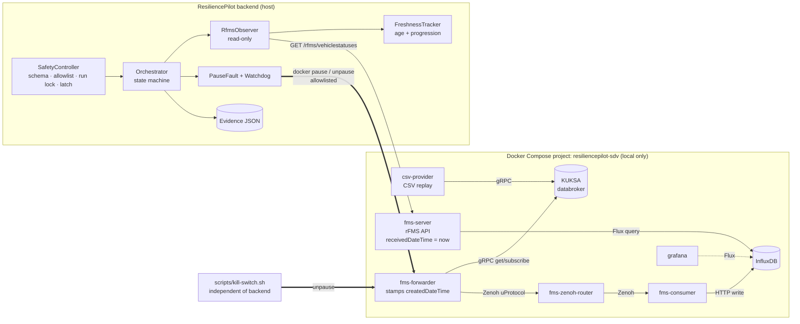

# ResiliencePilot SDV — Day-1 Judge Report

**Claim:** the Eclipse SDV Fleet Management rFMS API keeps answering **HTTP 200 with a fresh `receivedDateTime`
while vehicle telemetry is frozen**. ResiliencePilot detects this from the data itself. It injects the fault on
purpose behind a deterministic safety controller, rolls it back, and verifies recovery from new vehicle timestamps.
Every number below comes from a real run on 2026-10-10. The raw evidence is in [`reports/day1/`](../../reports/day1/)
(12 run records and 2 baselines). Target: upstream blueprint [`eclipse-sdv-blueprints/fleet-management`](https://github.com/eclipse-sdv-blueprints/fleet-management) @ `3d514ac72a`, Zenoh transport, run locally with Docker Compose.

## Architecture

## Dependency map (`config/dependency_map.json`, shown live by `resiliencepilot deps`)

Telemetry path: `csv-provider → databroker → fms-forwarder → fms-zenoh-router → fms-consumer → influxDB → fms-server`.

| Edge | Protocol | Confidence |
|---|---|---|
| csv-provider → databroker | gRPC publish | source, live network |
| fms-forwarder → databroker | gRPC get/subscribe | source, live network |
| fms-forwarder → zenoh-router → fms-consumer → influxDB ← fms-server | Zenoh / HTTP write / Flux query | source, **experiment**, live network |
| grafana → influxDB | Flux | source, live network (off the telemetry path) |

"source" = file:line in the blueprint (listed in the JSON). "experiment" = pausing the forwarder froze what
fms-server returns, in 11/11 runs. "live network" = both containers share a Docker network, checked each time it is
displayed. Timestamp origins: `createdDateTime` comes from `fms-forwarder/.../kuksa.rs:44` and is the freshness signal.
`receivedDateTime` is `Utc::now()` at request time (`fms-server/src/influx_reader.rs:372`), so it always looks fresh.

## Baseline (normal operation)

| | Reference `baseline-20261010T094007Z` | First `baseline-20261010T084740Z` |
|---|---|---|
| Samples | 60 polls @ 0.5 s (30 s) | 60 polls @ 0.5 s (30 s) |
| HTTP 200 / FRESH / STALE | 100 % / 60 / 0 | 100 % / 60 / 0 |
| Data age (s) min / median / p95 / max | 0.08 / 0.58 / 1.04 / 1.08 | 0.32 / 0.80 / 1.24 / 1.30 |
| `createdDateTime` advance interval | 1.002 s (1.001–1.004), 0 regressions | 1.002 s (1.001–1.004), 0 regressions |
| rFMS latency median / max | 21.9 / 31.5 ms | 11.9 / 20.5 ms |

**Load conditions** (recorded with the reference baseline): 1 vehicle (VIN `YV2E4C3A5VB180691`). CSV replay of
4,001 rows looping (`PROVIDER_INFINITE=1`). Forwarder `TIMER_INTERVAL=500ms`. One observer polling every 0.5 s. No
load generator. Other clients were not measured. Docker VM 7.68 GiB. The whole stack used ≈ 221 MiB and ≤ 0.67 % CPU
per container. The first baseline did not record load conditions. Its setup was identical, but that is not
measured evidence. The latency difference between the two baselines (11.9 → 21.9 ms within 53 min) is measured;
its cause has not been investigated.

**Stale threshold = 5 s**: about 4× the worst baseline age (1.30 s). There were no false positives in 184
baseline samples across 6 baselines.

## Experiment: `telemetry_stall` (`docker pause fms-forwarder`)

Timeline of a representative run (`20261010T094045Z-3155f1`, 12 s). t = 0 when `docker inspect` confirms
`Paused=true`.

| t (s) | Event |
|---|---|
| 0.00 | Fault active. The API keeps answering HTTP 200; `createdDateTime` frozen |
| **4.85** | **STALE detected while HTTP 200** |
| 11.88 | Fault window closed (duration elapsed) |
| 12.25 | Rollback verified (`docker unpause`, then inspect shows running and not paused) |
| 13.84 | First fresh vehicle data (+1.59 s) |
| **15.98** | **Recovery verified** (+3.73 s): 3 new `createdDateTime` values, all fresh and HTTP 200 |

All 6 runs that went to their full duration (10–12 s):

| Metric | min | median | max |
|---|---|---|---|
| HTTP 200 during the fault | 100 % | 100 % | 100 % |
| Time to detection | 4.77 s | 4.85 s | 5.27 s |
| Max data age reached | 10.06 s | 11.98 s | 12.22 s |
| Healthy-but-stale polls (of 20–24 fault-window polls) | 10 | 14 | 15 |
| Rollback → first fresh data | 0.53 s | 1.05 s | 1.59 s |
| Rollback → recovery verified | 2.64 s | 3.17 s | 3.73 s |

Time to detection is roughly the threshold (5 s) minus the data age at the moment of injection. It reflects the
threshold choice, not a property of the system.

## Safety evidence

| Control | Evidence |
|---|---|
| Kill switch (separate process) | 5 runs of 25 s each, stopped 4.1–4.2 s after injection. Rollback verified 0.35–0.37 s after the loop exited. Recovery verified in every run (2.12–3.15 s). One run with a precise shell timestamp: 0.6 s from switch to verified rollback. |
| Backend hard-killed mid-fault | Run `…084842Z-baf896`. The forwarder stayed paused, as expected. The kill switch unpaused it without the backend. The next start found the fault marker, latched `LATCHED_UNSAFE`, and refused new runs until a checked reset. |
| Second terminal during a live run | `status` showed BUSY with the owner's PID. `run` was refused. The live run was unaffected (COMPLETED). |
| Rules enforced in code | Strict schema. Allowlist plus compose-project label. One run at a time across processes. Total fault time ≤ 30 s, enforced by the watchdog. Latch on any unverified rollback or recovery. |
| Tests | 49 unit tests plus 3 live tests pass. They cover timeout, cancel, invalid or malformed input, concurrency, observer loss, rollback failure, recovery failure, and crash. |
| Independent review | 1 high and 5 medium issues found, all fixed with regression tests ([SAFETY_REVIEW.md](../testing/SAFETY_REVIEW.md)). |

## Run provenance

All 12 runs come from our own team's Day-1 sessions on 2026-10-10 against the same local stack. None came
from another team or an external source.

| Runs (`reports/day1/`) | Origin |
|---|---|
| `084750Z-2a256d`, `084814Z-b17ca6`, `084842Z-baf896`, `085706Z-db15a3` | Individual manual verification runs: first stall, kill switch, crash test, second-terminal test |
| `085221Z-98b877` + `085240Z-76d080` | Our demo session (`scripts/demo-day1.sh`) — rehearsal 1 |
| `085737Z-c9bda7` + `085754Z-05b39e` | Our demo session — rehearsal 2 (after the safety-review fixes) |
| `092158Z-43ca5b` + `092215Z-a107b5` | Our demo session — rehearsal 3 |
| `094045Z-3155f1` + `094104Z-25d49e` | Our demo session — rehearsal 4 (with the impact view); this log is in `day1-demo-run.log` |

Each demo-session pair is the script's 12 s stall followed by its 25 s kill-switch run. Both runs carry
`approved_by: demo-operator` and the script's hypothesis text.

## Limitations (honest)

- **The fault is a container pause, not a network fault.** There is no proxy anywhere in the stack, so no
  network-level degradation is claimed. Faults on the Zenoh/network layer are Phase 3 work.
- **1.0 s vs 500 ms is unexplained.** The forwarder timer is 500 ms, yet `createdDateTime` advances every
  1.002 s at the API in every baseline. The cause has not been investigated, and the results don't depend on it.
- Two early emergency-stop runs (`…084814Z`, `…085240Z`) are labelled COMPLETED. They ran before a review fix
  (L1); later runs are correctly labelled ABORTED.
- The watchdog runs in-process. A hard-killed backend leaves the fault in place until the kill switch runs or the
  backend restarts.
- Single vehicle and a single host. Results are from 11 runs, not a statistical study.
- Not yet built: AI analyst, dashboard, HTTP API, other experiment types (Phases 3–6).
- Not production software and not safety-certified.
